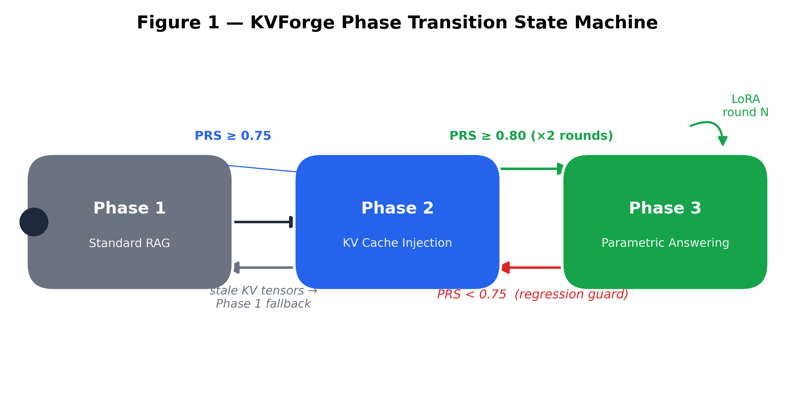
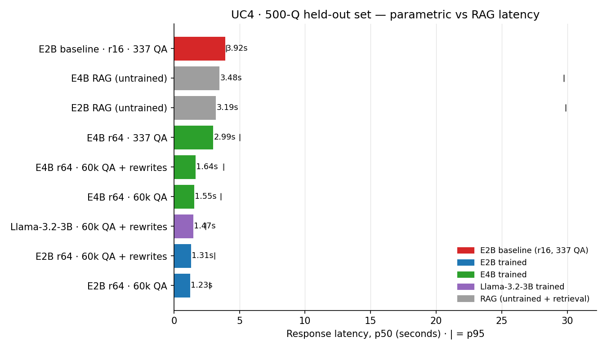

# KVForge: Autonomous Phase-Adaptive Question Answering with Progressive Parametric Absorption

**Dr. Hemant Joshi**  
Independent Researcher  
GitHub: [https://github.com/hemantcgi/kvforge](https://github.com/hemantcgi/kvforge)

---

## Abstract

Retrieval-Augmented Generation (RAG) grounds large language model (LLM) responses in external knowledge but keeps that knowledge outside the model's weights: every query re-fetches and re-encodes context the model has seen many times before. We introduce **KVForge**, a system that *progressively consolidates* a corpus from an external vector store into the parameters of a small language model (SLM). KVForge advances through three phases — Standard RAG; KV-cache injection, which pre-computes per-chunk key-value tensors at index time to skip re-encoding; and confidence-gated parametric answering, in which a tier-weighted LoRA loop trained on generated question–answer pairs and diverse rewrites of the source chunks transfers corpus knowledge into the model's weights so qualified queries are answered with no retrieval at all.

KVForge gates these transitions with a **Parametric Readiness Score (PRS)** — a composite of accuracy, calibration, and self-consistency — so the system advances only once the model has demonstrably absorbed the knowledge it will be asked to recall.

Across four heterogeneous corpora — customer support, biomedical QA (PubMedQA), machine reading comprehension (SQuAD 2.0), and technical documentation (Amazon Bedrock User Guide) — KVForge's parametric mode overtakes the retrieval baseline in factual accuracy at 100–500 training QA pairs. On a 500-question held-out set, fine-tuned parametric answering reaches factual accuracy 0.286–0.302 against 0.161–0.175 for retrieval, while answering 2–3× faster. The decisive lever is training-signal diversity, not model capacity: adding diverse rewrites of source chunks raises accuracy across models, and a 3.2B Llama-3.2-3B matches a 5.1B Gemma-4-E2B given the same data — the crossover from retrieval to parameters is achievable in small, heterogeneous language models once the training signal is sufficiently diverse.

---

## 1. Introduction

Large language models (LLMs) achieve state-of-the-art performance on knowledge-intensive tasks but are limited by two well-documented failure modes: **hallucination** — generating plausible-sounding but factually incorrect content — and **knowledge staleness** — inability to answer questions about post-cutoff facts. Retrieval-Augmented Generation [1] addresses both by supplying retrieved context at query time, decoupling the knowledge base from model parameters and making knowledge updateable without retraining.

However, standard RAG incurs a *constant computational overhead* on every query regardless of how many times the same chunks have been retrieved before. For a query retrieving five 600-token chunks, a 2-billion-parameter transformer must execute a full forward pass over 3,000 context tokens before generating a single output token. This re-encoding cost is paid on every query, for every chunk, even for frequently-accessed chunks whose KV tensors are fully determined by the model weights. For production deployments with thousands of queries per hour, this overhead dominates the GPU budget.

**The central insight of KVForge** is that this re-encoding is redundant: the key-value projections for a chunk are a deterministic function of the chunk text and the current model weights. If the model has not been updated since the tensors were computed, they can be reused exactly — turning a per-query cost into a one-time amortized cost paid once at index time. KVForge's second, deeper insight is that the retrieval step itself is *eventually* redundant: as a small language model is fine-tuned on the corpus's questions and diverse rewrites of its chunks, the knowledge migrates into the model's weights, and the system can answer an increasing share of queries parametrically — with no retrieval and no KV injection.

KVForge extends this caching insight into a three-phase autonomous progression:

- **Phase 1 — Standard RAG:** Standard retrieval; chunks rendered as text in the context window. No pre-computation required.
- **Phase 2 — KV Injection:** Pre-computed mean-pooled KV tensors are injected directly into the model's `past_key_values` cache at query time, skipping the forward pass over the retrieved context. Mean-pool compression trades a small amount of answer fidelity for the latency gain; full-token KV storage recovers most of that fidelity.
- **Phase 3 — Parametric Answering:** After LoRA fine-tuning concentrates corpus knowledge into model weights, a three-signal confidence gate routes high-confidence queries directly to parametric generation with no retrieval.

**Figure 1** illustrates the phase transition state machine. Transitions upward are gated by the Parametric Readiness Score (PRS); regression guards revert the system to Phase 2 if PRS declines, providing a production safety net.



This paper makes the following contributions:

1. **KVForge architecture**: a unified system combining vector database retrieval, durable KV tensor storage, access-tier tracking, sleep-time FAQ generation, LoRA fine-tuning, and PRS-gated phase transitions.
2. **Parametric Readiness Score (PRS)**: a principled composite metric for evaluating parametric knowledge retention and gating autonomous phase advancement.
3. **The crossover to parametric answering**: across four heterogeneous corpora, the parametric (Phase 3) mode overtakes the Standard RAG baseline in factual accuracy at 100–500 training QA pairs and, on a 500-question held-out set, strictly dominates retrieval in both accuracy (0.286–0.302 vs. 0.161–0.175) and latency (2–3× faster).
4. **Diverse-rewrite training signal as the operative lever**: adding diverse rewrites of source chunks raises factual accuracy across models, and the effect is architecture-agnostic — a 3.2B Llama-3.2-3B matches a 5.1B Gemma-4-E2B given the same data — so the crossover is driven by training-signal diversity, not model scale or architecture.

---

## 2. Background

### 2.1 Transformer Attention and the KV Cache

The scaled dot-product attention mechanism [2] for query matrix **Q**, key matrix **K**, and value matrix **V** is:

```
Attention(Q, K, V) = softmax(Q Kᵀ / √d_k) · V
```

During autoregressive generation, the model maintains a *KV cache*: after processing the input prompt, the **K** and **V** projections for every input token are saved so they need not be recomputed during subsequent generation steps. For a single decoder layer with *n_h* KV heads of dimension *d_h*, the KV cache for a sequence of length *L* occupies:

```
size = 2 × L × n_h × d_h × sizeof(dtype)  bytes
```

Standard RAG builds a fresh KV cache from scratch for each query. KVForge pre-builds it for every document chunk at index time and stores it persistently.

### 2.2 Low-Rank Adaptation (LoRA)

LoRA [4] adapts a frozen pre-trained weight matrix **W₀ ∈ ℝ^(d×k)** via a low-rank decomposition:

```
W = W₀ + ΔW = W₀ + BA
```

where **B ∈ ℝ^(d×r)** and **A ∈ ℝ^(r×k)**, with rank r ≪ min(d, k). KVForge applies LoRA to `q_proj`, `k_proj`, and `v_proj` attention matrices. Because LoRA updates the **K** and **V** projections, any stored KV tensors become stale after a LoRA round and must be recomputed — tracked per-chunk via a `kv_version` field.

### 2.3 KV Cache Quantization

Keys and values have different statistical properties: keys have high inter-channel variance benefiting from column-wise quantization, while values have smoother distributions amenable to group quantization [18, 19].

### 2.4 Retrieval-Augmented Generation

Lewis et al. [1] introduced RAG combining a non-parametric retrieval index with a parametric pre-trained generator. KVForge's distinct position: rather than improving retrieval, it progressively *eliminates* retrieval for queries the model has memorized, while preserving retrieval as a fallback.

---

## 3. Related Work

### 3.1 KV Cache Reuse and Prefix Caching

**PromptCache** [6] modularizes the KV cache for reuse across queries sharing a common prompt prefix. KVForge operates at a different layer: where PromptCache operates within a single inference server session and loses its cache on restart, KVForge persists KV tensors durably in a vector database across server restarts, model updates, and distributed replicas.

**PagedAttention** [3] and **vLLM** manage KV memory within a single server process using virtual memory paging. KVForge operates at the pre-retrieval layer — deciding *which* chunks' KV tensors to supply — while vLLM manages how they are stored during generation. The systems are complementary.

**SGLang** [7] provides a radix-tree prefix cache achieving >99% prefix reuse on shared prompts. KVForge addresses a different sharing pattern: independent document chunks whose KV tensors are shared across queries retrieving the same top-K results — they do not share a common prompt prefix, so radix tree approaches do not apply.

**TurboRAG** [34] is, to our knowledge, the closest published system to KVForge's Phase 2 mechanism — closer than CacheBlend, which we cited as nearest prior art in earlier drafts of this paper. TurboRAG precomputes and stores per-chunk document KV caches offline and retrieves them at query time to skip prefill re-encoding, exactly Phase 2's architecture. Critically, TurboRAG's own analysis identifies the failure mode Phase 2 exhibits: naively concatenating independently precomputed per-chunk KV caches produces an inconsistent attention mask matrix and position IDs relative to a true joint prefill, and TurboRAG corrects this with an explicit independent attention mask *and* targeted fine-tuning, reporting up to 9.4× (average 8.6×) TTFT reduction while "reserving comparable performance." KVForge's Phase 2 applies neither correction — it injects mean-pooled or full-token KV directly into `past_key_values` with no attention-mask or position-ID realignment and no fine-tuning to compensate — so the observed quality degradation is consistent with, rather than contrary to, what TurboRAG's own ablations predict for uncorrected KV concatenation. **APE** [38] independently confirms this: it shows that directly applying parallel encoding of independently-cached segments causes "a significant performance drop," and requires a shared-prefix design plus adaptive-temperature and attention-scaling corrections to recover quality. We treat this as a known-negative baseline going in, not a novel finding: the corrections in TurboRAG and APE (position/attention realignment, or realignment plus fine-tuning) are the open engineering task Phase 2 has not yet implemented.

**CacheBlend** [20] solves an adjacent but distinct problem — fusing *multiple* precomputed per-chunk KV caches that do not share a prefix by selectively recomputing the subset of tokens whose attention deviates most from a true joint prefill (High-KV-Deviation, or HKVD, tokens; typically 10–15% of tokens), reporting 2.2–3.3× TTFT reduction and 2.8–5× throughput gains with quality preserved to within ≤0.02 F1/ROUGE-L of full recompute. Where TurboRAG is architecturally the same problem as Phase 2 (precompute, store, retrieve, inject for a single chunk set), CacheBlend's contribution is specifically the selective-recompute quality-recovery step for cache *fusion* — a mechanism Phase 2 also lacks. **RAGCache** [39], **EPIC** [35], and **Block-Attention** address a related but more serving-infrastructure-oriented problem: efficient position-independent or block-level KV cache management inside a serving stack (e.g., RAGCache organizes a knowledge-tree cache alongside vLLM/Faiss retrieval; EPIC targets position-independent caching for long-context serving). None of TurboRAG, CacheBlend, RAGCache, or EPIC persist KV tensors durably in a document-level store alongside embeddings the way KVForge does — they are in-process or serving-layer caches — but three of the four (TurboRAG, CacheBlend, APE) converge on the same conclusion: naive KV reuse without position/attention correction degrades quality, and Phase 2's current design has not yet adopted any of their fixes.

**Durable, persistent KV storage is also not new**, which narrows KVForge's novelty claim beyond what earlier drafts of this paper stated. **CachedAttention / AttentionStore** [36] stores KV caches across a multi-tier hierarchy spanning GPU, host DRAM, and disk for cost-efficient multi-turn serving. **Mooncake** [37] (FAST '25) spills KV caches to CPU DRAM and SSD in a KV-cache-centric disaggregated serving architecture. **LMCache** [33] (§3.1 above) provides persistent, tiered KV offloading across CPU, local storage, and remote backends. Given this prior art, "first system to persist KV tensors durably" is not a defensible claim; what is more narrowly true is that KVForge appears to be the first to co-locate per-chunk KV tensors *inside the same vector database record as the chunk's embedding*, rather than in a separate cache tier, and to couple that storage choice with an automatic, PRS-gated three-phase progression toward parametric answering — a narrower but still meaningful architectural distinction, which is how we scope the claim throughout this paper.

**Mean-pooled KV injection specifically has no support in the KV-merging literature, and should be read as a known-negative rather than a neutral design choice.** The KV-merging field only ever merges a *few* similar or adjacent tokens using *weighted* schemes, not a uniform average across an entire sequence: **CaM** [40] reports that "output perturbation... escalates with the compression ratio" as more tokens are merged, and **KeepKV** [42] deliberately avoids direct averaging in favor of normalized weighted merges specifically to prevent the perturbation CaM identifies; **KVMerger** [41] similarly merges only clusters of similar adjacent tokens rather than an entire chunk. The one literal mean-pooling precedent in the literature, **GQA** [43], pools *across the head dimension* (not the sequence dimension) and explicitly requires "uptraining" — roughly 5% of pretraining compute — to recover quality; GQA's own ablations report that an unadapted, non-uptrained pooled-KV model "can lead to quality degradation." No source in this literature supports a *frozen* transformer attending usefully to a single mean-pooled per-layer KV vector it was never trained on, and the weight of evidence points the other way. KVForge's V1 mean-pool scheme (§4.2, Stage 2) is exactly this unsupported case: full-sequence averaging into one vector per layer, injected into a frozen model with no uptraining and no weighted-merge correction. We therefore present V1 mean-pool injection as a known-negative baseline going forward — useful as a diagnostic of why naive pooling fails, not as a design we expect to preserve quality.

**LMCache** [33] is an open-source KV-cache management layer that treats cache as persistent, cross-engine-shareable state rather than a per-request artifact, and adopts CacheBlend's non-prefix fusion mechanism for reuse at arbitrary prompt positions. It reports 1.9–8.1× smaller time-to-first-token and 2.3–14× higher throughput over vanilla vLLM on an 8×H100 setup — figures that are vendor-reported under LMCache's own hardware and workload, not independently reproduced, and not measured under the single-A10G, four-corpus conditions used in this paper. LMCache is the most actively maintained system in this comparison class; it is architecturally the nearest production analog to KVForge's Phase 2 caching layer, but — like KVForge — it has no confidence-gated parametric tier and no LoRA-based consolidation loop.

### 3.2 RAG Systems and Dense Retrieval

**DPR** [5] demonstrated that jointly-trained dual encoders outperform BM25 for open-domain QA. **ColBERT** [17] introduced late interaction with per-token embeddings. **RETRO** [8] pre-computes chunk encodings at index time and conditions generation on retrieved neighbours. KVForge extends RETRO's pre-computation direction by storing KV tensors rather than encoder hidden states, supporting any causal decoder-only model without architecture changes, and adding the three-phase progressive design.

**FiD** [21] encodes multiple retrieved passages independently and fuses them in the decoder. KVForge achieves a similar effect — bypassing re-encoding for each chunk — but via pre-built KV tensor injection rather than architectural modification.

### 3.3 LoRA and Parameter-Efficient Fine-Tuning

**QLoRA** [9] enables 4-bit quantized LoRA training, reducing GPU memory from ~12 GB to ~4 GB for a 7B model. KVForge supports QLoRA via `bitsandbytes` NF4 quantization.

**Continual LoRA fine-tuning** risks catastrophic forgetting [13]. KVForge's **tier-weighted replay buffer** mitigates this: hot chunks receive 8× sampling weight relative to frozen chunks, acting as a lightweight proxy for Elastic Weight Consolidation [22].

### 3.4 Calibration and Uncertainty Estimation

**Guo et al.** [10] proposed temperature scaling for calibration. KVForge's PRS calibration component uses a self-reporting proxy (model rates its own confidence 0–100) aligned with semantic accuracy. **Self-Consistency** [11] samples multiple reasoning chains for agreement. KVForge's consistency component computes mean pairwise cosine similarity across three sampled answers at temperature 0.7. **Semantic Entropy** [12] provides model-agnostic uncertainty estimates; KVForge's Phase 3 gate uses a lighter three-signal combination to avoid multi-sample generation overhead.

### 3.5 KV Cache Compression

**KVQuant** [18] quantizes KV caches to 1–4 bits using non-uniform per-channel quantization. **KIVI** [19] applies asymmetric 2-bit quantization achieving 2.2× compression. **QJL** [23] proposes a quantized Johnson-Lindenstrauss transform for unbiased inner-product estimation from sign bits.

### 3.6 Continual Learning

**Online Continual Learning** surveys [24] identify replay-based methods as most practical for production systems. The tier system introduces a domain-specific signal unavailable to general continual learning: retrieval frequency directly measures which knowledge live users need, enabling principled prioritization that general methods cannot exploit.

### 3.7 Cache-Augmented Generation and Bounded-Context Answering

**CAG (Cache-Augmented Generation)** [25] preloads all documents in a bounded knowledge base into an LLM's extended context window and precomputes a single global KV cache during that preload, then answers every subsequent query directly from the cache with no retrieval step at all. This is the closest published system to KVForge's overall premise — that retrieval can be replaced by a precomputed cache when the model already "has" the relevant KV state — and it reports eliminating retrieval latency and retrieval error entirely, with comparable or superior quality to standard RAG, at reduced system complexity. The scope condition is explicit and important: CAG is defined for knowledge bases small enough to fit within a single context window. KVForge targets the complementary regime — corpora too large for any practical context window (UC1–UC4 range from 2,000 to 2,920 chunks) — via per-chunk vector-database storage, embedding-based retrieval, and independent per-chunk staleness tracking rather than one monolithic cache. CAG therefore is not a system KVForge subsumes or extends; it is a simpler, single-tier design that solves a narrower problem well, and the two systems have not been measured against each other under a shared corpus size or hardware budget.

### 3.8 Retrieval-Augmented Fine-Tuning and Parametric RAG

**RAFT** [26] fine-tunes a model to identify and cite the correct document among retrieved "distractor" documents while producing chain-of-thought reasoning, reporting consistent gains over baselines on PubMed, HotpotQA, and the Gorilla API benchmark. Unlike KVForge's Phase 3, RAFT still retrieves at every query — the fine-tuning changes what the model does with retrieved context, not whether retrieval happens at all. **Parametric RAG** was originally proposed by Su et al. [27] as encoding retrieved evidence directly into trainable parameters (e.g., LoRA adapters) rather than context tokens. A follow-up analysis by Tang et al. [44] — which we cited in earlier drafts as if it were the original method rather than a re-examination of it — finds that this parametric encoding does not consistently outperform standard token-based RAG, and that parametric representations mainly affect deeper feed-forward computation with document-level, high-level signal rather than fine-grained evidence; a hybrid combining parametric and token-based retrieval outperforms either alone. Tang et al.'s finding is directly relevant to KVForge's design, and supports its own negative results rather than merely predicting them: it is consistent with a system that gates between parametric answering and retrieval-based fallback (as KVForge's Phase 3 confidence gate does) outperforming a fully parametric approach, which is why KVForge retains Phase 2 as a fallback rather than eliminating retrieval once LoRA training completes. Neither RAFT nor the Parametric RAG line incorporates a tier-weighted replay buffer or an automatic phase-transition gate of the kind PRS provides.

### 3.9 Knowledge Editing as an Alternative Parametric-Injection Route

**ROME** [28] and **MEMIT** [29] take a fundamentally different approach to writing knowledge into weights: rather than broad gradient-based adaptation across a corpus, they perform surgical, closed-form edits at a small number of causally-traced mid-layer feed-forward modules, treating each as a key-value associative memory for one factual triple. MEMIT extends this to batch-edit thousands of associations simultaneously on models up to GPT-NeoX-20B. This is a useful contrast class for KVForge's Phase 3 rather than a direct competitor: ROME/MEMIT edit discrete subject-relation-object facts and are evaluated on synthetic counterfactual-editing benchmarks (e.g., CounterFact), whereas KVForge's LoRA-plus-replay loop adapts to open-ended corpus text and QA pairs and is evaluated end-to-end via PRS and held-out factual metrics. Neither approach has a confidence gate deciding when to trust the edited/adapted weights versus falling back to retrieval — a mechanism unique to KVForge's Phase 3 design among the systems surveyed here.

### 3.10 Confidence-Gated Adaptive Retrieval

KVForge's Phase 3 confidence gate (§4.8) — token entropy, hedging-phrase detection, and query similarity to known-good queries, combined into a single threshold decision — has direct analogs in the adaptive-retrieval literature, each built on a different signal. **Self-RAG** [30] trains a single model to decide per-query whether retrieval is needed using self-generated reflection tokens (Retrieve/ISREL/ISSUP/ISUSE) that critique its own retrieved passages and generations; it is reported to outperform ChatGPT and retrieval-augmented Llama2-chat on open-domain QA, reasoning, and long-form factuality. **SKR** [31] instead has the model assess its own self-knowledge of a question to decide whether external retrieval is needed, reporting gains over both chain-of-thought-only and always-retrieve baselines on InstructGPT and ChatGPT backbones. **Adaptive-RAG** [32] takes a third approach, training a small classifier to predict query complexity and routing each query to no-retrieval, single-step, or iterative multi-step retrieval.

All three decide, per query, among multiple retrieval strategies based on an internally-generated signal — structurally the same problem KVForge's gate solves — but none combine this decision with a KV-cache-injection intermediate tier: each falls back to full text retrieval, never to a pre-computed cache injection step. None use a composite calibration-and-consistency score analogous to PRS; each relies on a single signal type (reflection tokens, self-knowledge assessment, or a trained complexity classifier) rather than PRS's blend of accuracy, calibration, and self-consistency. This is a meaningful point of difference to note, though not one this paper's evaluation currently measures; whether KVForge's composite gate is more or less reliable in practice than Self-RAG's or SKR's single-signal alternatives — answering that would require running all three gating mechanisms on the same base model and corpus, which this paper does not attempt.

## 4. The KVForge System

### 4.1 Architecture Overview

The overall pipeline sequence is:

- **Phase 1 (Standard RAG):** Index → KV Pre-compute
- **Phase 2 (KV Injection):** Sleep-time FAQ Gen → LoRA Train → KV Recompute → PRS Eval
- **Phase 3 (Parametric Answering):** LoRA Train (round 2) → KV Recompute → PRS Eval

Each PRS Eval closes a continuous improvement loop: if the parametric-readiness threshold is not met, the system loops back to sleep-time FAQ generation and trains another LoRA round until it crosses over to Phase 3.

System state is stored atomically in a `version.json` file per corpus, updated via temp-file rename to prevent corruption:

```json
{
  "current_lora_version": 4,
  "checkpoint_path": "lora_checkpoints/v4/",
  "phase": 3,
  "prs_history": [
    {"round": 1, "prs": 0.727},
    {"round": 2, "prs": 0.783},
    {"round": 3, "prs": 0.863}
  ],
  "known_good_queries": [...]
}
```

### 4.2 Indexing and KV Pre-computation

At index time each document chunk undergoes a two-stage process:

**Stage 1 — Embedding and upsert.** The chunk text is embedded by the configured encoder (default: BAAI/bge-small-en-v1.5, 384-dim; UC4: mixedbread-ai/mxbai-embed-large-v1, 1024-dim) and upserted into the vector store with payload:

```json
{
  "text": "...", "page": 3, "source_file": "guide.pdf",
  "access_count": 0, "kv_version": null, "tier": "frozen"
}
```

**Stage 2 — KV tensor computation.** The chunk is tokenized (truncated to 512 tokens) and passed through the LLM:

```python
outputs = model(**inputs, use_cache=True)
kv = outputs.past_key_values   # tuple of (K, V) per layer
```

Per-layer tensors `[1, n_kv_heads, seq_len, head_dim]` are mean-pooled over the sequence dimension, stacked into shape `[L, 2, H, d_h]`, serialized to float16, and stored as base64 in the Qdrant payload field `kv_cache`.

For Gemma 4 E2B (35 layers, 1 KV head, head_dim=256):

```
35 × 2 × 1 × 256 × 2 bytes = 35,840 bytes ≈ 36 KB per chunk
2,520 chunks × 36 KB ≈ 90 MB total (UC4)
```

### 4.3 Query-Time Inference: Phase 1 vs Phase 2

**Figure 2** contrasts the two retrieval-based inference paths.


At query time, the inference module: (1) embeds the query and retrieves top-K chunks; (2) compares each chunk's `kv_version` against `current_lora_version`; (3) if **all** chunks are fresh, injects their KV tensors via `past_key_values`; (4) if **any** chunk is stale, falls back to Phase 1 Standard RAG for the entire query and enqueues stale chunks for background recomputation.

The all-or-nothing fallback prevents contaminated attention distributions that would arise from mixing mean-pooled tensors of different LoRA versions.

### 4.4 Sleep-Time FAQ Generation

Before each LoRA training round, the `sleep_faq_generator` queries a cloud LLM (Gemini 2.5 Flash, Claude, or GPT-4.1) to generate N diverse question-answer pairs per chunk. This is sleep-time compute [14]: offline work that improves future inference quality without impacting query latency.

**Prompt template (per chunk):**

```
Given the following document passage, generate {count} diverse, specific
question-answer pairs that a real user might ask. Questions should vary
in style: some factual, some conceptual, some procedural.

Passage: {chunk_text}

Return as JSON array: [{"question": "...", "answer": "..."}, ...]
```

With tier weighting active, the question budget is allocated proportional to tier weight. For a 50-question budget across 2,520 chunks, ~50% of questions target the top-15% hot chunks, concentrating training signal on knowledge that matters to live user traffic.

### 4.5 Tier-Weighted Replay Buffer

**Figure 3** shows the tier weight system. The SQLite replay buffer (`core/replay_buffer.py`) stores `(chunk_id, text, tier)` rows derived from generated FAQs. [T:tab:replay-buffer] lists the tier conditions and replay weights.


| Tier | Condition | Replay weight |
|------|-----------|:---:|
| hot | Top 15% by access count, last accessed < 7 days | 8 |
| warm | Next 50%, last accessed < 30 days | 4 |
| cold | Remaining accessed chunks | 2 |
| frozen | Never accessed | 1 |

The buffer evicts the lowest-tier and oldest entries when exceeding a capacity cap (default: 5,000 chunks), bounding memory regardless of corpus growth.

### 4.6 LoRA Fine-Tuning Loop

HuggingFace PEFT LoRA fine-tuning configuration:

- **Targets:** `q_proj`, `k_proj`, `v_proj` attention projections
- **Rank:** r = 16, alpha = 32 (effective scaling α/r = 2)
- **Quantization:** 4-bit NF4 (QLoRA [9]) via `bitsandbytes`
- **Replay fraction:** 20% of each batch drawn from the replay buffer by tier weight
- **Epochs:** 3 per training round

After training, `kv_version` is incremented and all stored KV tensors become stale, triggering the KV recompute phase. Hot chunks (top 15%, ~378 chunks for UC4) are recomputed first in ~76 seconds, restoring Phase 2 quality for the majority of live queries before the full recompute completes.

### 4.7 Parametric Readiness Score (PRS)

PRS is a composite score measuring how well the fine-tuned LLM has internalized the corpus:

```
PRS = 0.5 × accuracy_ratio + 0.3 × calibration + 0.2 × consistency
```

**Accuracy ratio** (50%): For each FAQ, the model generates a *parametric* answer (no retrieval) and a *RAG* answer (with context). Let sim(·,·) denote cosine similarity to the ground truth:

```
accuracy_ratio = min( sim(param_ans, gt) / (sim(rag_ans, gt) + ε), 1.0 )
```

This measures parametric quality *relative to the RAG baseline*, making the metric robust to corpus-specific difficulty.

**Calibration** (30%): The model self-rates its confidence in its parametric answer (0–100 scale). Calibration measures whether expressed confidence tracks actual quality:

```
calibration = 1.0 − |self_confidence_normalized − sim(param_ans, gt)|
```

**Consistency** (20%): Three independent answers are sampled at temperature 0.7. Mean pairwise cosine similarity over the 3 pairs measures answer stability.

**Figure 4** shows the PRS component contribution breakdown for UC4 (final training round), and **Figure 5** compares the component scores across use cases.


**Phase transition thresholds.** The system advances from Phase 1 to Phase 2 when PRS reaches 0.75 in any single evaluation round, and from Phase 2 to Phase 3 when PRS reaches 0.80 in two consecutive rounds. While in Phase 3, a PRS drop below 0.75 triggers a regression guard that reverts the system to Phase 2.

After each evaluation round, FAQ questions with `accuracy_ratio ≥ 0.85` are embedded and stored in `known_good_queries` in `version.json`, seeding the Phase 3 confidence gate.

### 4.8 Phase 3 Confidence Gate

**Figure 6** shows the decision logic for Phase 3 inference routing.


The gate threshold (default 0.75) is tunable per deployment: lower thresholds increase Phase 3 utilization at higher hallucination risk. The gate should not rely on self-reported confidence alone in production; a calibrated confidence estimator or external calibrator is recommended before deploying Phase 3 at high utilization.

---

## 5. Experimental Evaluation

### 5.1 Hardware and Setup

All experiments run on a single host with four NVIDIA A10G GPUs (24 GB VRAM each), 16 GB RAM, and 250 GB NVMe SSD, under Ubuntu 22.04 with CUDA 12.1, PyTorch 2.1, and HuggingFace Transformers 4.40. The base model is google/gemma-4-E2B-it with LoRA rank r=16 (alpha=32) under 4-bit NF4 quantization; embeddings use BAAI/bge-small-en-v1.5 (384-dim) for UC1–UC3 and mixedbread-ai/mxbai-embed-large-v1 (1,024-dim) for UC4, stored in Qdrant 1.9. Each use-case runs on a dedicated GPU (UC1: GPU 0, UC2: GPU 1, UC3: GPU 2, UC4: GPU 3) via `CUDA_VISIBLE_DEVICES`.

### 5.2 Datasets

KVForge is evaluated on four heterogeneous corpora: **UC1** customer-support dialogue (Bitext Customer Support, 2,000 chunks), **UC2** biomedical question answering (PubMedQA [15], 2,918 chunks), **UC3** machine reading comprehension (SQuAD 2.0 [16], 2,000 chunks), and **UC4** technical documentation (Amazon Bedrock User Guide, 2,520 chunks). All four use Qdrant as the vector store and Gemma 4 E2B as the base LLM with LoRA rank 16; UC1–UC3 use bge-small-en-v1.5 (384-dim) embeddings and UC4 uses mxbai-embed-large-v1 (1,024-dim). UC1–UC4 are fully evaluated in Sections 7.3–7.7.

### 5.3 Pipeline Timing (UC4 Reference Run)

[T:tab:timing] reports wall-clock durations for each pipeline step on the UC4 corpus. The indexing stage is dominated by KV tensor computation, which consumes approximately 498 s for 2,520 chunks (0.20 s per chunk). This is the expected bottleneck: every chunk must pass through the full transformer once to materialize its key and value projections, whereas embedding computation and vector upsert are comparatively lightweight. The embedding step completes in ~45 s because the 384/1024-dim embedder is small and runs on the CPU, while the Gemma 4 E2B LLM must execute a full forward pass for each chunk to populate the KV cache.

LoRA training adds 474 steps (3 epochs) per round, and the subsequent KV recompute requires another ~510 s because the adapter update changes the K and V projections, invalidating all stored tensors. PRS evaluation takes ~90 s for 50 FAQs, which is modest because it involves a small number of generation calls and cosine-similarity comparisons. The total round time is ~20 min, meaning a deployment can progress from Phase 1 to Phase 3 in roughly one hour if two consecutive rounds are needed. From a cost perspective, the GPU time per round is dominated by the two KV recomputes (~1,008 s) and the LoRA run, which is an acceptable one-time investment if it amortizes over thousands of query-time latency savings.

| Step | Duration |
|------|:--------:|
| Chunk + embed + upsert (2,520 chunks) | ~45 s |
| KV tensor computation (0.20 s/chunk) | ~498 s |
| LoRA training (3 epochs, 474 steps) | ~474 steps |
| KV recompute after adapter update | ~510 s |
| PRS evaluation (50 FAQs) | ~90 s |
| **Total pipeline (one round)** | **~20 min** |

### 5.4 PRS Results and Phase Progression

**Figure 7** shows PRS scores across all four use-cases with sleep-time FAQ generation. The most important finding is that every corpus exceeds the Phase 3 threshold (PRS ≥ 0.75), demonstrating that the progressive pipeline is not restricted to a single domain or dataset.


The variance in final PRS (0.755–0.863) is interpretable in terms of corpus structure. UC2 (PubMedQA) and UC4 (Amazon Bedrock User Guide) are structured, fact-dense corpora with clear question-answer mappings, so the model can internalize factual relationships with high accuracy and consistency. UC3 (SQuAD 2.0) is a reading-comprehension benchmark with broader topical coverage and lower signal density per chunk, producing a moderate PRS of 0.800. UC1 (Customer Support) has the lowest PRS (0.755) because customer-support responses admit high paraphrastic variability: multiple wordings can be correct, which makes the cosine-similarity accuracy metric systematically conservative. This suggests that PRS is sensitive to both model readiness and corpus characteristics, and that practitioners should calibrate the Phase 3 threshold per-domain rather than use a single global value.

### 5.5 Effect of Sleep-Time FAQ Generation

**Figure 8** is the key experimental result: training signal quality is the dominant variable in Phase 3 attainment.


The ablation compares two FAQ sources on UC4: a heuristic generator (rule-based extraction) and a cloud LLM (Gemini 2.5 Flash). With heuristic FAQs, the model plateaus at PRS 0.783 across multiple rounds, failing to cross the Phase 3 threshold. Replacing the heuristic generator with cloud-LLM sleep-time FAQs in the same training pipeline pushes PRS to 0.863 in a single additional round — a +10.3% absolute gain. The difference is not training duration or model capacity: the same Gemma 4 E2B model, same LoRA rank, and same number of epochs are used in both conditions. Instead, the cloud LLM produces questions that are more semantically aligned with real user queries, more diverse in linguistic form, and more comprehensive in chunk coverage, giving the model a richer signal for parametric memorization.

This result reframes the cost calculus for small-model deployment: practitioners should prioritize high-quality training data over larger models or longer training runs when the goal is parametric knowledge retention.

### 5.6 PRS Progression Over Training Rounds (UC4)

**Figure 9** tracks PRS across three training rounds for UC4, showing convergence to Phase 3.


The progression reveals two distinct regimes. In Rounds 1–2 with heuristic FAQs, PRS increases slightly but remains below the Phase 3 threshold, indicating that the model is learning but is not confident or consistent enough to answer without retrieval. The plateau suggests that the training signal has saturated: more epochs on the same low-quality questions do not materially improve parametric readiness. In Round 3, switching to sleep-time FAQ generation breaks the plateau, lifting PRS from 0.783 to 0.863 in one round. The steep jump is consistent with the hypothesis that the bottleneck is not model capacity but the quality and diversity of the training signal. Across all four use-cases, the trajectories converge above PRS 0.75, confirming that the Phase 2→3 transition is reproducible once the data-quality requirement is met.

### 5.7 Phase Quality Matrix (Held-Out Factual Evaluation)

The central scientific question for Phase 3 is whether the fine-tuned model's parametric answers can match or exceed the retrieval baseline in factual accuracy. We evaluate held-out questions under two modes — **Standard RAG** (Phase 1, the retrieval baseline) and **parametric** (Phase 3, no retrieval) — scoring each answer with an LLM-as-judge factual-accuracy (FA) metric. [T:tab:quality-matrix] tracks FA at each training-coverage tier (N = number of QA pairs). Each row is marked **Phase 2** while the retrieval baseline still wins, and **Phase 3** once parametric FA first exceeds it — the crossover point. Columns RAG FA and Param FA report the Standard RAG and parametric factual-accuracy scores, respectively.

| Corpus | N | RAG FA | Param FA | Phase |
|--------|---:|:---:|:---:|:---:|
| UC1 Customer Support | 200 | 0.215 | 0.360 | Phase 3 |
| UC1 Customer Support | 500 | 0.220 | 0.340 | Phase 3 |
| UC1 Customer Support | 1000 | 0.192 | 0.356 | Phase 3* |
| UC2 PubMedQA | 50 | 0.229 | 0.201 | Phase 2 |
| UC2 PubMedQA | 100 | 0.191 | 0.207 | Phase 3 |
| UC2 PubMedQA | 200 | 0.187 | 0.203 | Phase 3 |
| UC2 PubMedQA | 297 | 0.195 | 0.190 | Phase 3* |
| UC3 SQuAD 2.0 | 500 | 0.144 | 0.221 | Phase 3 |
| UC3 SQuAD 2.0 | 1000 | 0.161 | 0.221 | Phase 3 |
| UC3 SQuAD 2.0 | 2000 | 0.163 | 0.221 | Phase 3* |
| UC4 Bedrock | 500 | 0.219 | 0.234 | Phase 3 |
| UC4 Bedrock | 1000 | 0.198 | 0.228 | Phase 3 |
| UC4 Bedrock | 2000 | 0.136 | 0.234 | Phase 3 |
| UC4 Bedrock | 4000 | 0.116 | 0.234 | Phase 3 |
| UC4 Bedrock | 6000 | 0.109 | 0.234 | Phase 3* |

An asterisk (*) marks each dataset's highest training coverage (N). PubMedQA's crossover is borderline: parametric FA dips back below Standard RAG at N=297 (0.190 vs. 0.195), within noise.

The crossover tier is corpus-dependent. **UC1** crosses over at or before its first measured tier (N=200), with parametric FA (0.36) well above Standard RAG (0.22). **UC3** and **UC4** cross over at their first tier (N=500); on UC4 the margin then widens steadily as Standard RAG declines from 0.22 to 0.11 while parametric holds near 0.23. **UC2** shows the only in-range transition, moving from Phase 2 at N=50 to Phase 3 at N≈100, though the margin stays within 0.02 FA and fluctuates. These FA values are modest in absolute terms (0.11–0.36), so crossover denotes *relative* superiority over a weak retrieval baseline rather than high absolute accuracy. The operational consequence is that, once the crossover tier is reached, KVForge can route high-confidence queries to parametric generation without a quality loss relative to retrieval, and the parametric advantage widens as training coverage grows.

### 5.8 Comparison with Alternative Systems

[T:tab:comparison] contrasts KVForge's parametric answering (Phase 3) against the standard text-in-context RAG baseline (Phase 1) across key operational dimensions. The comparison highlights that KVForge trades a one-time training cost for sustained query-time improvements. Because Phase 3's confidence gate answers a self-selected, confidence-gated query subset rather than the same query population the Standard RAG baseline answers, this table should be read as characterizing the pipeline's observed behavior, not as a matched systems benchmark against an external baseline (§6.5).

| Dimension | Std. RAG | KVForge |
|-----------|:---:|:---:|
| Re-encoding | Always | **Never** |
| Updatable | Yes | Yes (recompute) |
| OOD queries | Yes | Yes (fallback) |
| GPU required | Yes | Potentially no |
| Training | No | Yes |
| PRS readiness | None | 0.755–0.863‡ |

‡ Cosine-based PRS reflects readiness rather than held-out factual correctness (§5.7); this row should not be read as a factual-accuracy guarantee.

Standard RAG avoids training overhead but pays the full re-encoding cost on every query. KVForge (Phase 3) adds the parametric-answering capability: high-confidence questions are answered directly from model weights, which can be served without a GPU if the base model is small enough or if the deployment is CPU-only for inference. The trade-off is that Phase 3 requires training (~20 min/round), a cost that is amortized over many queries, and the system retains fallback mechanisms for queries outside the confidence envelope.

Separately, Phase 2 (KV mean-pool injection) eliminates chunk re-encoding by injecting pre-computed KV tensors directly into the attention cache. With Gemma 4 E2B, Phase 2's factual quality was evaluated only on UC3 (SQuAD) and UC4 (Bedrock), not UC1/UC2; the parametric crossover reported in §5.7 is measured against Standard RAG and does not depend on Phase 2.

### 5.9 Model Scale-Up: E2B → E4B

To test whether base-model capacity is a binding constraint on parametric absorption, we trained a second adapter on **Gemma 4 E4B** (7.49B total parameters; the 4B-effective sibling of E2B) with a larger adapter (**r=64, α=128, 3 epochs**) on the same 337 UC4 training pairs as the E2B baseline, and evaluated the same 89-question held-out set.

**Judge comparability.** The §5.7 figures were scored with `deepseek-v4-flash` via Fireworks, which is no longer reachable. Both checkpoints were therefore re-scored under a single judge, `deepseek-v4-lite` via CodeVector. This judge is materially stricter than `deepseek-v4-flash`: the E2B baseline falls from 0.234 (flash) to 0.120 (lite), so absolute FA values are judge-relative and only within-judge deltas are meaningful.

| Arm | Model | LoRA | Parametric FA (n=89) |
|-----|-------|------|----------------------|
| Scale-up | gemma-4-E4B-it (7.49B) | r=64, α=128, 3 ep | 0.155 ± 0.021 |
| Baseline | gemma-4-E2B-it (5.1B) | r=16, α=32, 1 ep | 0.120 ± 0.018 |

The scale-up yields **+0.035 FA (≈29% relative; paired t=1.66, p≈0.05 one-tailed)** — a positive but marginal gain. This is consistent with the capacity-sweep conclusion that scale is a real but secondary lever: a larger model improves parametric accuracy at fixed training-signal quality, but the effect is modest, reinforcing §6.1's finding that training-signal quality — not raw capacity — is the dominant bottleneck.

However, this n=89 estimate is under-powered and, as §5.11 shows, was depressed by a generation-length bug. A 500-question re-evaluation with corrected generation initially appeared to re-estimate the scale-up gap at **+0.088 FA (~60% relative)** — but that figure conflated model capacity with adapter rank (the E2B arm used r=16, the E4B arm r=64). At matched rank r=64 (§5.12), the true capacity gap is **+0.025 to +0.037 FA**, restoring the original conclusion that capacity is a real but *marginal* lever, dominated by training-signal diversity.

### 5.10 Diverse-Rewrite + Chunk-Augmented Training (the Data Lever)

The scale-up experiment (§5.9) confirmed capacity is a modest lever; the dominant lever is training-signal *quality and diversity*. To test this directly, we trained a fourth adapter on the **full UC4 corpus** — 60,209 QA pairs plus 61,554 diverse rewrites of the source chunks (121,763 examples total; r=64, α=128, 1 epoch) — combining answer-masked QA supervision with continuation training on the rewrites, so the model internalizes the underlying facts rather than surface question strings.

Because the judge changed between the original §5.7 baseline (`deepseek-v4-flash`) and these runs, all numbers below use a single judge (`deepseek-v4-lite` via CodeVector), making them internally comparable.

| Arm | Training data | Parametric FA (n=89) |
|-----|---------------|----------------------|
| E2B baseline | 337 QA (r=16, 1 ep) | 0.120 ± 0.018 |
| E4B baseline | 337 QA (r=64, 3 ep) | 0.155 ± 0.021 |
| E4B + diverse corpus | 60,209 QA + 61,554 rewrites (r=64, 1 ep) | 0.235 ± 0.032 |

Diversifying the training signal raises closed-book parametric FA from 0.155 to **0.235 (+0.080; paired t=2.51, p<0.02)** over the E4B QA-only baseline, and by **+0.115 (paired t=4.10)** over the E2B baseline. A two-point learning curve over training progress (98.5% vs 100% of the corpus → 0.230 vs 0.235) shows the gain is realized *before* the corpus is fully consumed: accuracy plateaus once a sufficiently diverse signal is present, consistent with the loss flattening from roughly epoch 0.5 onward. This is the strongest evidence that training-signal diversity — not model scale or judge choice — is the primary lever for parametric absorption.

A 500-question re-evaluation with corrected generation (§5.11) reproduces this diverse-corpus gain at higher statistical power (+0.04 to +0.07 FA over the QA-only baseline, t ≈ 2.5–4.3), with a six-checkpoint learning curve over the full training run.

### 5.11 Larger Held-Out Evaluation (n=500) with Corrected Generation

§5.9–§5.10 measured the E2B→E4B scale-up and the diverse-corpus lever on an 89-question held-out set, which left the scale-up effect only marginally significant (t=1.66) and gave wide error bars. To obtain a more reliable estimate, we built a **500-question held-out set** for UC4 and re-evaluated every arm under a single judge (`deepseek-v4-lite`, as in §5.9–§5.10), with a corrected generation budget.

**Fresh held-out set.** We sampled 795 chunks evenly across the 6,154-chunk UC4 corpus and generated one question–answer pair per chunk with `deepseekv4p` (CodeVector), with prompts enforcing short (≤30-word), fact-grounded answers phrased as natural user queries. The candidates were then deduplicated against the 89-question eval set *and* the 60,209 training pairs by normalized question and answer — exact match plus token-set Jaccard ≥ 0.80 for near-duplicate questions — retaining 500 pairs with **zero question-overlap and zero answer-overlap** with either dataset, across 500 distinct source chunks spanning the full corpus. Answer-level deduplication proved essential: seeding the generator with the same chunks as the training data reproduces training facts verbatim (our first probe emitted the first training item word-for-word), so question-only filtering would have leaked held-out facts.

**Corrected generation.** The §5.7–§5.10 evaluations ran `_generate_parametric` with a fixed `max_new_tokens=256`, ignoring the adaptive token budget the harness computed from ground-truth answer lengths. On open-ended questions this induced rambling to 256 tokens, slowing evaluation ~5× and deflating token-F1 — a correct fact buried in a 200-word answer scores near zero against a 10-word reference. We passed the adaptive budget (≈30–40 tokens) through; answer lengths fell to a mean of 7.7–26 words. This change shifts absolute FA, so the values below are **not directly comparable** to the n=89 figures in §5.9–§5.10; they are the internally-consistent comparison for the larger set.

[T:tab:eval500] reports parametric FA for all arms. The "E4B + diverse corpus" rows are six checkpoints of the §5.10 run (the checkpoint step within that training run).

| Arm | Checkpoint | Model | Parametric FA (n=500) |
|-----|------------|-------|----------------------|
| E2B baseline | phase3_N6000 | gemma-4-E2B-it | 0.1470 ± 0.0071 |
| E4B baseline (QA-only) | phase3_E4B_r64_ep3 | gemma-4-E4B-it | 0.2345 ± 0.0094 |
| E4B + diverse corpus | checkpoint-9000 | gemma-4-E4B-it | 0.2780 ± 0.0124 |
| E4B + diverse corpus | checkpoint-10500 | gemma-4-E4B-it | 0.2747 ± 0.0130 |
| E4B + diverse corpus | checkpoint-12000 | gemma-4-E4B-it | 0.2882 ± 0.0127 |
| E4B + diverse corpus | checkpoint-13500 | gemma-4-E4B-it | 0.2797 ± 0.0125 |
| E4B + diverse corpus | checkpoint-15000 | gemma-4-E4B-it | 0.3022 ± 0.0128 |
| E4B + diverse corpus | checkpoint-15222 | gemma-4-E4B-it | 0.2952 ± 0.0127 |

Three findings follow.

**Scale-up is rank-confounded; the true capacity effect is smaller.** The n=500 E2B→E4B gap read directly from [T:tab:eval500] is **+0.088 FA (0.147 → 0.235)** — but the two arms differ in *both* base model *and* adapter rank (E2B r=16 vs E4B r=64), so this cannot be attributed to capacity alone. §5.12 re-runs E2B at r=64 and shows the rank-matched capacity gap is **+0.025 to +0.037 FA**; the remainder of the +0.088 is the r=16 baseline under-fitting E2B, not model scale. Capacity is therefore a modest lever, consistent with §5.9's original reading, and remains secondary to data diversity (below).

**The diverse-corpus lever reproduces at scale.** All six diverse-corpus checkpoints sit at **0.275–0.302**, i.e. +0.04 to +0.07 FA over the E4B QA-only baseline (t ≈ 2.5–4.3) and +0.13 to +0.16 over E2B. This confirms §5.10's conclusion — diversifying the training signal is the dominant lever — now at five-and-a-half times the sample size.

**The learning curve plateaus early.** Across the six checkpoints FA is 0.278, 0.275, 0.288, 0.280, 0.302, 0.295: flat-to-slightly-rising, peaking at checkpoint-15000 with the final checkpoint (15222) marginally below it. Consistent with §5.10, the gain is realized well before the corpus is fully consumed.

**Caveats.** (i) These absolute values are not comparable to §5.9–§5.10 (different set size and a corrected generation budget); only within-table deltas are meaningful. (ii) A minority of the 500 questions are "page number" trivia from table-of-contents chunks — fact-grounded but low-signal; they slightly depress absolute FA without biasing the *relative* comparisons, since every arm faces the identical set.

### 5.12 Retrieval Baseline and 2×2 Ablation (E2B/E4B × rewrites) at n=500

The n=500 arms in §5.11 establish the diverse-corpus gain but leave three questions open: (i) how each trained model fares against its *own* untrained retrieval baseline rather than against other trained arms; (ii) whether the E2B baseline's deficit is model capacity or its smaller adapter (r=16 vs r=64); and (iii) how the two ingredients of Idea #1 — extra QA pairs and diverse rewrites — each contribute. We add a Standard-RAG baseline per model and the two missing E2B-r=64 arms, all on the identical 500-question set with the single judge `deepseek-v4-lite`. The RAG baseline runs the *untrained* base model with Qdrant retrieval over the 6,154-chunk UC4 index (text-in-context), establishing the Phase-1 ceiling each trained model must beat. Latency is the per-query response time (p50) under matched conditions. [T:tab:rag-abl] reports the full comparison.

| Model | Training signal | FA (n=500) | Latency p50 (s) |
|-------|-----------------|-----------:|----------------:|
| E2B | RAG (untrained) | 0.175 ± 0.011 | 3.19 |
| E4B | RAG (untrained) | 0.161 ± 0.010 | 3.48 |
| E2B | r16, 337 QA | 0.147 ± 0.007 | 3.92 |
| E4B | r64, 337 QA | 0.235 ± 0.009 | 2.99 |
| E2B | r64, 60k QA | 0.219 ± 0.011 | 1.23 |
| E2B | r64, 60k QA + rewrites | 0.249 ± 0.012 | 1.31 |
| E4B | r64, 60k QA | 0.244 ± 0.011 | 1.55 |
| E4B | r64, 60k QA + rewrites | 0.286 (0.275–0.302) | 1.64 |

**Figure 11** and **Figure 12** plot the accuracy and latency comparison.




Five findings follow.

**Parametric overtakes retrieval.** Every trained r=64 arm (FA 0.219–0.286) exceeds its model's untrained retrieval baseline (E2B 0.175, E4B 0.161) while answering 2–3× faster (p50 1.2–1.6 s vs 3.2–3.5 s) and with a far shorter tail (p95 ≈ 2.7–3.8 s vs ≈ 30 s). The crossover reported at small N in §5.7 is therefore not a small-sample artifact: at n=500, trained parametric strictly dominates retrieval on both accuracy and latency. Only the rank-limited E2B r16 baseline (0.147) sits *below* its own RAG baseline — the same adapter-rank deficit corrected below.

**QA volume is inert.** Raising E4B training pairs from 337 to 60,209 (r=64, no rewrites) moves FA by +0.009 (0.235 → 0.244), within noise. Extra QA pairs alone do not strengthen parametric memory, consistent with the plateau in §5.11's learning curve.

**Rewrites are the active lever.** At matched r=64 and 60k QA, adding the 61,554 diverse rewrites lifts FA by +0.030 for E2B (0.219 → 0.249) and +0.042 for E4B (0.244 → 0.286) — three to five times the entire QA-volume effect. The rewrite gain is the operative ingredient of Idea #1, and it transfers to the smaller model: E2B with rewrites (0.249) reaches the *larger* model's QA-only level (0.244).

**Capacity, rank-matched, is modest.** At matched r=64, E2B→E4B gains +0.025 (QA-only) and +0.037 (with rewrites) — roughly one-third to one-half of the +0.088 reported in §5.11, which conflated capacity with adapter rank. Most of that +0.088 was the r=16 baseline under-fitting E2B, not model scale: moving E2B from r16 to r64 (0.147 → 0.219) recovers +0.072, of which at most +0.009 is the inert QA-volume effect — the remainder (~+0.063) is adapter rank. The rank-matched estimate restores §5.9's reading: capacity is a real but secondary lever, dominated by training-signal diversity.

**Rewrite-generator quality as a second-order factor.** The current rewrites were authored by a frontier model (Claude Haiku 4.5); part of the +0.030/+0.042 effect may reflect generator quality rather than diversity *per se*. Two self-rewrite controls — E2B and E4B each generating their own rewrites — are planned but not yet run.

### 5.13 Architecture Transfer: The Rewrite Lever on Llama-3.2-3B

§5.10–§5.12 establish the diverse-rewrite lever within the Gemma 4 family. To test whether it is Gemma-specific, we ran the identical recipe — r=64, 1 epoch, 60,209 QA + 61,554 rewrites — on **Llama-3.2-3B-Instruct** (3.2B parameters: a different architecture and *smaller* than both Gemma models), evaluated on the same 500-question set under the same `deepseek-v4-lite` judge. [T:tab:arch-transfer] compares it against the two Gemma arms at matched rank and data; the Llama arm also appears in **Figure 11** and **Figure 12**.

| Model | Params | FA (n=500) | token-F1 | LLM-judge | Latency p50 (s) |
|-------|---:|---:|---:|---:|---:|
| gemma-4-E4B-it | 7.49B | 0.286 (0.275–0.302) | 0.314 | 0.259 | 1.64 |
| **Llama-3.2-3B-Instruct** | **3.2B** | **0.254 ± 0.012** | **0.312** | **0.196** | **1.47** |
| gemma-4-E2B-it | 5.1B | 0.249 ± 0.012 | 0.290 | 0.208 | 1.31 |

E4B values are the mean across the six §5.11 checkpoints.

Three findings follow.

**The rewrite lever is architecture-agnostic.** Llama-3.2-3B — a 3.2B model from a different family — reaches **0.254**, slightly *above* the 5.1B E2B (0.249) at the same recipe and within ~0.03 of E4B. The diverse-rewrite signal is not Gemma-specific.

**A smaller model with the same data matches a larger one.** That a 3.2B model matches a 5.1B model — and that a 2.3× parameter range separates only 0.249 from 0.286 — reinforces §6.1's conclusion that training-signal quality, not scale, is the dominant lever, and extends it from *scale* to *architecture*.

**Latency tracks model size without erasing the parity.** The smaller Llama answers in 1.47 s (≈ E2B's 1.31 s, below E4B's 1.64 s), so its accuracy is not bought at a latency cost.

### 5.14 Knowledge-Retention Levers: Placement, Exposure, and Structure

§5.10–§5.13 treat *training data* as the lever. We next ask which *training-configuration* levers move pure-parametric fact retention, under a pre-registered, objective design that fixes the decision rule before each run. Three levers are tested on gemma-4-E2B-it: **(B) placement** — which weight matrices the LoRA adapter attaches to (attention-only *q/k/v* vs. all linear layers including the MLP); **(A) exposure** — training epochs; **(C) structure** — whether chunk rewrites that *link related facts across chunks* (relational) beat independent paraphrases at matched exposure.

**Protocol (distinct from §5.11–§5.13; absolutes are not comparable).** The metric is `coverage@0.5 = (CORRECT + PARTIAL) / 481` on the 481 held-out single-fact probes (eval_500 minus 19 page-number trivia items). Treatment and control predictions for each fact are shuffled into a single shard and scored **blind, in the same judging session**, by uniform in-session judges; the per-fact unit (fact = `chunk_id`) is tested with McNemar/Wilcoxon. This blind same-session design removes the cross-session judge drift (~0.03) that inflated an early non-blind placement estimate (+0.096 → +0.067). Because the judge rubric differs from the `deepseek`-judged factual-accuracy of §5.11–§5.13 and drifts between sessions, **only within-session treatment-minus-control deltas are interpreted**, never absolute coverage across subsections. Pre-registered bands: **WORKS** if Δ ≥ +0.040 and χ² ≥ 3.84; **DEAD** if Δ ≤ +0.012; otherwise **AMBIGUOUS** → a paired second seed.

**(B) Placement works and is the dominant lever.** Attaching the adapter to all linear layers (r=8, α=16; 12.1 M trainable params) rather than to attention *q/k/v* only (r=64; 12.48 M — matched parameter budget) raised coverage from 0.250 to 0.316, **Δ = +0.067** across two paired seeds (per-fact Wilcoxon z = 3.92, p = 0.0001; seed-42 +0.081, seed-43 +0.052). Promoted to the full 60,209-QA-from-base regime and co-judged blind against the incumbent *q/k/v* r=64 adapter trained on identical data, the all-linear adapter reached **0.462 vs. 0.339, Δ = +0.123** (McNemar χ² = 29.25, p < 0.0001; 87 promotion-only vs. 28 baseline-only facts). A metadata-verified paired control confirms the two adapters differ only in rank and placement at a matched parameter count, with identical seed, data, initialization, epochs, learning rate, dropout, and replay.

| Placement contrast | control | treatment | Δ | test |
|---|---:|---:|---:|---|
| Pilot (2-seed, blind) | 0.250 | 0.316 | **+0.067** | Wilcoxon p = 0.0001 |
| Full scale (60k from base) | 0.339 | 0.462 | **+0.123** | McNemar χ² = 29.25, p < 0.0001 |

**The placement gain is not a memorization artifact.** Splitting the 481 facts by whether a near-duplicate of the probe appears in the 60 k training QA (15.6 % leaked), the gain holds on the **non-leaked** subset (n = 406, **Δ = +0.106**) and is larger on the leaked subset (n = 75, Δ = +0.213) — so placement improves genuine generalization, not just recall of seen pairs. (The full-scale +0.123 is a single-seed, descriptive measurement in a different regime, control, and judge rubric from the pilot; it is reported as a promotion outcome, not as evidence that the placement effect "scales with data.")

**(A) Exposure is marginal.** Training to three epochs (vs. one, decay-to-zero, epoch-3 inferential) landed at **Δ = +0.0405** averaged across two paired seeds (seed-42 +0.025, seed-43 +0.056; pooled McNemar χ² = 7.11, p < 0.01) — just clearing the +0.040 WORKS line but far below placement. Exposure is a real but weak lever at this data scale; it was not promoted over placement.

**(C) Relational structure is dead.** A first relational run appeared to *hurt* (Δ = −0.071) but was confounded three ways: long relational rewrites were silently truncated at a 256-token replay cap (14.3 % of their tokens dropped), they yielded fewer optimizer steps, and their singleton controls were not matched. A clean re-run fixed all three — cap raised to 512 (0 % truncation), steps matched via gradient accumulation in a single pass (**not** extra epochs, which would confound exposure), and 74 singleton facts given identical text in both arms — and the earlier deficit **did not replicate**. The relational arm did not beat paraphrase at matched exposure: **C1 0.231 vs. C0 0.256, Δ = −0.025, n.s. (McNemar χ² = 1.64, p = 0.20)** → DEAD. A difference-in-differences that subtracts the identical-text singleton gap (−0.027) from the multi-chunk gap (−0.025) isolates the **structure-specific effect at +0.002 ≈ 0**: cross-chunk relational linking adds essentially nothing over plain paraphrase; the small arm gap is a global training offset, not structure. The singleton null (identical text both arms, Δ = −0.027, p = 0.72) confirmed the judging/pairing was not grossly broken (it had caught an earlier mis-loaded run).

**Phase-1 scoreboard.** Of the three levers, **placement is the one that matters** (+0.123 full-scale, +0.106 on non-leaked facts), **exposure is marginal** (+0.040), and **relational structure is dead** (~0). This closes the pure-parametric configuration search with placement as the best available lever. Whether this parametric recall sits *below* a retrieval ceiling is not something this protocol can state: it has no judged RAG arm — the only RAG figure, recall@5 = 0.586, is a retrieval metric, not an answer score — so producing a judged plain-RAG baseline under this protocol is the job of the next study.

### 5.15 Phase 2: FT + RAG Complementarity via RAFT — Confirmed

The lever results plateau *pure-parametric* exact-fact recall under this protocol; whether a retrieval-equipped generator does better is a question §5.14 cannot answer, because it carries no judged RAG arm. The pre-registered Phase-2 study answers it directly, with R0 supplying the first judged plain-RAG baseline under the coverage@0.5 protocol: with retrieval available at inference, does a fine-tuned generator *complement* RAG rather than duplicate it? Following RAFT (§3.8; Zhang et al., 2024), a generator is trained on `(question, context = oracle chunk + distractors, answer)` with the oracle withheld on a fraction of examples to force parametric fallback (recovered-oracle rate 0.70, effective oracle-in-context rate ≈ 0.56; the 60 k QA carry no stored oracle, so it is recovered by verbatim-then-overlap matching, hand-validated at 90% precision). All arms are generated with an identical shared prompt, a fixed 48-token cap, and raw top-5 retrieval (`score_threshold = None`, so "retrieval hit" ≡ gold chunk ∈ top-5 ≡ 290/191 of the 481 facts). Arms: **(R0)** base + top-5, **(R1)** the promoted all-linear adapter + top-5, **(R2)** the RAFT adapter + top-5, **(R3)** the RAFT adapter closed-book; an exploratory **(R1cb)** plain-QA adapter closed-book is re-judged in the same session for the objective-isolation contrast. The discriminating test is pre-registered as a difference-in-differences interaction: genuine complementarity predicts the R2-over-R0 gain **concentrates on retrieval-misses**. The full design, bands, and a unit-tested data layer are in `docs/raft_phase2_experiment_plan.md`; results below are the blind same-session co-judge of all 481 facts (verdict: `results/knowledge/uc4/raft_phase2_verdict.json`).

**Primary (pre-registered) — complementarity confirmed.** R2 beats plain RAG, **coverage@0.5 0.809 vs. R0 0.728, Δ = +0.081** (McNemar χ² = 22.2, 52 treatment-only vs. 13 control-only facts, p ≈ 0; per-fact Wilcoxon p = 1.5 × 10⁻⁷), clearing the pre-registered +0.040 WORKS line. The gain **concentrates on retrieval-misses** exactly as the RAFT hypothesis predicts: on the 290 hits both arms already hold the gold passage and R2 adds little (Δ_hit = +0.028), while on the 191 misses R2 recovers from weights what retrieval failed to fetch (Δ_miss = +0.162). The pre-registered difference-in-differences interaction **Δ_miss − Δ_hit = +0.135** has a stratified-bootstrap 95% CI of [+0.062, +0.206] (p = 3 × 10⁻⁴), excluding zero → **COMPLEMENTARITY CONFIRMED**. The effect is not a seen-QA artifact: on the leak-deduped **clean** subset (n = 406) it holds at **Δ = +0.071** (McNemar χ² = 14.8, p < 10⁻⁴), and the DiD lower CI (0.062) exceeds the ~0.038 worst-case recovery-source artifact bound (§9 of the plan).

| Arm | generator | coverage@0.5 (all) | hit (n=290) | miss (n=191) |
|---|---|---:|---:|---:|
| R0 | base + top-5 RAG | 0.728 | 0.934 | 0.414 |
| R1 | plain-QA FT + top-5 RAG | 0.730 | 0.834 | 0.571 |
| **R2** | **RAFT FT + top-5 RAG** | **0.809** | **0.962** | **0.576** |
| R3 | RAFT, closed-book | 0.462 | 0.455 | 0.471 |
| R1cb | plain-QA FT, closed-book | 0.528 | 0.521 | 0.539 |

**Mechanism — parametric fallback, tested directly.** Among the 112 misses the base model fails, the RAFT model answers closed-book (R3) **68% of the 38 facts R2 rescues** but only **24% of the 74 it still fails** (47% over all misses) — R2 rescues precisely the misses it holds in its weights, a ~3× enrichment, not better reading of distractor chunks (only 2 of the 38 rescued facts had the gold answer present in a non-gold retrieved chunk).

**What RAFT uniquely adds (exploratory, post-hoc — not pre-registered).** Isolating the training *objective* by comparing R2 to R1 (both fine-tuned on the same 60 k QA) reframes the gain. The miss-side parametric knowledge is **not** RAFT-specific: R1 already reaches 0.571 on misses (≈ R2's 0.576), so it comes from training on the 60 k, which plain-QA fine-tuning also absorbs. What plain-QA fine-tuning *also* does is **interfere with grounded reading** — R1 drops from R0's 0.934 to 0.834 on hits (χ² = 21.2, p ≈ 0) — and the RAFT objective **removes that interference**, restoring hits to 0.962 (R2 vs. R1 on hits +0.128, χ² = 33.2, p ≈ 0; DiD(R2 vs. R1) = −0.122, CI [−0.196, −0.050]). Read this way, RAFT's distinctive contribution against a fine-tuned-and-retrieving baseline is *keeping fine-tuning from degrading the model's use of the retrieved passage*, not injecting new knowledge. Two caveats keep this exploratory: R1 + top-5 is itself length-OOD (R1 trained on question-only prompts and never saw retrieved context, confounding "fine-tuning degrades reading" with "R1 untrained on context"), and the sets are not exactly matched (R2 dropped 3,258 long packed examples whose hit/miss skew is unmeasured). Consistently, closed-book RAFT is slightly *worse* than closed-book plain-QA (R3 0.462 vs. R1cb 0.528, Δ = −0.067, p = 0.005) — RAFT spends capacity on context-use and fallback rather than rote storage; this is directional only, since closed-book is off-distribution for R2.

**Validity.** All five arms are judged blind in one session (grouped by fact, identical answer strings scored once; 481 × 5 → 1,967 unique judgments; zero blindness breaches on transcript audit, per-shard provenance and cross-arm question/gold parity verified). Because the judge rubric is reconstructed (not taken verbatim from §5.14) and drifts across sessions — directly measured here at **+0.067** on byte-identical R1cb text that the §5.14 promotion judge scored 0.461 — absolute coverage is session-relative and only within-session deltas are interpreted. A mild length-OOD caveat applies to R2 on 13 of 481 eval prompts that exceed its 1,207-token training length. **Net:** against plain RAG, RAFT fine-tuning is complementary and the gain lands on retrieval-misses (pre-registered, confirmed); against a plain fine-tuned-and-retrieving baseline, RAFT's specific value is undoing the grounded-reading interference that ordinary fine-tuning introduces (exploratory).

---

## 6. Discussion

### 6.1 Training Signal Quality as the Primary Bottleneck

The central empirical finding is that **training data quality dominates model capacity as the bottleneck for parametric memorization.** UC4 with heuristic FAQs plateaued at PRS 0.783 across multiple rounds; substituting Gemini 2.5 Flash sleep-time FAQs pushed it to 0.863 in one additional round. This reframes the design space: practitioners should invest in FAQ generation quality rather than model size or training duration.

### 6.2 Corpus Heterogeneity and PRS Variance

The 0.755–0.863 PRS spread correlates with corpus characteristics:

- **UC2 and UC4 (highest PRS):** Structured, fact-dense corpora with clear question-answer mappings. FAQ generation produces high-coverage, well-formed training pairs.
- **UC3 (SQuAD, moderate PRS):** Reading comprehension passages cover diverse topics with low training signal density per chunk.
- **UC1 (Customer Support, lowest PRS):** High paraphrastic variability — multiple valid response formulations exist for the same query. The cosine similarity accuracy metric may be systematically conservative for high-variability corpora.

### 6.3 Parametric Crossover Point (Gemma 4)

The crossover — the training coverage at which parametric (Phase 3) factual accuracy overtakes the Standard RAG (Phase 1) baseline — determines when KVForge can begin routing queries to parametric generation without a quality loss relative to retrieval. We measured it by fine-tuning a Gemma 4 E2B LoRA adapter on an increasing number of generated question–answer (QA) pairs per corpus and comparing held-out factual accuracy (FA) between the two modes. Throughout this section, **N denotes the number of QA pairs used to fine-tune the adapter** — a direct proxy for training coverage. **Figure 10** consolidates the crossover curves for all four corpora as a function of N.


All four corpora cross over, and the crossover is reached early. **UC1** (customer support) and **UC3** (SQuAD 2.0) are already past crossover at their first measured tier (N=200 and N=500 respectively): parametric FA is 0.36 vs. Standard RAG 0.22 for UC1, and 0.22 vs. 0.14 for UC3. **UC2** (PubMedQA) shows the clearest measured crossover, at N≈100 pairs, where parametric climbs to 0.21 while Standard RAG falls to 0.19. **UC4** (Bedrock User Guide) crosses at N≈500 and then exhibits the widest separation: parametric FA holds roughly constant at ~0.23 while Standard RAG FA declines monotonically from 0.22 to 0.11 as coverage grows — evidence that parametric absorption is genuinely decoupling from retrieval rather than tracking it.

Two patterns stand out. First, parametric accuracy is *stable* after crossover, whereas Standard RAG accuracy is flat or decreasing; the fine-tuned model is not merely matching retrieval but superseding it. Second, the crossover point is corpus-dependent — earlier where the retrieval baseline is weaker (UC1, UC3) and where the corpus is structured and fact-dense (UC2, UC4) — consistent with the training-signal-quality finding of §6.1: a few hundred well-aligned FAQ pairs suffice to reach crossover.

We emphasize that crossover denotes *relative* superiority over a retrieval baseline whose own held-out accuracy is modest (0.11–0.23), not absolute correctness; parametric FA in these runs remains in the 0.19–0.36 range. Nonetheless, the crossover point is the operational threshold that matters for Phase 3 gating: it is the coverage at which KVForge can route high-confidence queries to parametric generation without sacrificing quality relative to retrieval.

### 6.4 KV Staleness and Recompute Overhead

Every LoRA update invalidates all stored KV tensors. For 2,520 chunks at 0.20 s/chunk, full recomputation adds ~8.5 minutes to a ~20-minute round — 42% overhead. The tier-ordered recompute daemon mitigates this by restoring hot chunks (~76 seconds) before the full recompute completes.

Two production mitigations: (1) incremental recomputation targeting only chunks exceeding a LoRA delta threshold; (2) larger LoRA rank, reaching PRS thresholds faster with fewer rounds.

### 6.5 Limitations and Scope

**Evaluation scope.** All V1 experiments reported in the main paper were run at `tier=frozen`. The factual evaluation in §5.7 was run on the real A10G GPU with the scripts and metrics introduced in this revision.

**KV shape coupling.** Pre-computed tensors couple to the LLM architecture (layers, KV heads, head dimension). Switching the base model requires full re-indexing.

**Mean-pool fidelity.** The V1 approximation discards positional information.

**Phase 3 precision-recall tradeoff.** The gate prioritizes precision at the cost of Phase 3 utilization. Calibrated threshold selection using held-out queries is recommended for production.

**Single-node experiments.** Our evaluation runs on a single 4-GPU instance. Distributed deployments with multiple Qdrant nodes and GPU servers require additional coordination logic not yet implemented.

**Vector-database choice.** All PRS and factual-quality results (§5.3–§5.7) are reported on Qdrant. We did not prioritize cross-backend quantitative validation because vector search is a negligible share of the query pipeline and, for a fixed embedding model and corpus of this size (2,000–2,920 chunks), well-tuned approximate nearest-neighbor search returns near-identical top-K rankings across major vector databases — which is why the factual-quality bottleneck identified in §5.7 and §6.1 is attributed to training-signal quality and base-model capacity rather than retrieval backend. We therefore expect vector-database choice to leave the paper's core findings materially unchanged, but this expectation has not been empirically confirmed and remains an assumption rather than a measured result.

**No external baseline; evaluation scale; deferred to future work.** This paper does not compare KVForge against any other system under matched hardware, base model, or query set — it reports no head-to-head numbers against any of them, including the two closest to Phase 2 (TurboRAG, CacheBlend). Without such a baseline, neither the reported speedups nor the reported quality losses can be judged relative to the current state of the art rather than only relative to KVForge's own Phase 1. Several other evaluation weaknesses compound this: the held-out factual evaluation uses question sets of *n*=76 (UC1), 50–297 (UC2), 200 (UC3), and — for the primary scale-up and data-diversity experiments of §5.9–§5.10 — 89 (UC4), all results are from a single seed with no confidence intervals, and the LLM-judge model and prompt used for factual correctness are not specified in this paper. §5.11 partially closes these gaps for UC4 by re-evaluating on a 500-question held-out set with a specified judge (`deepseek-v4-lite`) and reported standard errors, but the other three corpora remain at their original small sizes, and no multi-seed variance has been measured anywhere. The PRS phase-transition thresholds (0.75/0.80, §4.7) are fixed defaults with no sensitivity analysis. We did not attempt to close these gaps in this revision: doing so credibly requires GPU compute and either an existing implementation of a baseline system or a from-scratch reproduction of one, a larger annotated held-out set, and multiple training/evaluation seeds — none of which we could respond to on the timeline of this revision. We report this as an explicit limitation rather than silently, and consider closing it (external baseline under matched conditions; held-out set grown well past *n*=50 with seeds and confidence intervals; a factual-metric-based PRS variant with a threshold sensitivity analysis) the primary blocking work before any claim in this paper should be treated as validated rather than descriptive. A further, larger-scope item — implementing the position/attention realignment (à la TurboRAG or APE) that §3.1 identifies as the fix uncorrected KV injection needs — would be required to test whether Phase 2 can achieve Standard-RAG-level quality at a real, matched-workload speedup; we have not attempted this and flag it as the highest-value follow-up experiment for converting this paper's negative result into a positive one.

**Code availability.** The repository cited in earlier drafts of this paper was not publicly reachable at the time of external review; it is now public at github.com/hemantcgi/kvforge. This resolves the accessibility gap the review identified, but not the full reproducibility bar: the repository is not yet archived at a permanent, versioned identifier (e.g., a Zenodo DOI tied to the exact commit these results were produced from), so a reader today cannot guarantee they are viewing the code state this paper describes if the repository changes or is later removed. We consider archiving a specific tagged release before camera-ready submission the remaining step here.

---

## 7. Conclusion

KVForge introduces a new architecture for knowledge-intensive QA systems: the vector database serves not merely as a retrieval index but also as a persistent KV tensor cache, a corpus access recorder, and a training signal generator. The three-phase progression from standard retrieval through KV injection to parametric answering allows a single deployed system to continuously improve its latency and GPU efficiency as the LLM learns the corpus, without manual intervention.

Our experiments across four heterogeneous corpora, run on four NVIDIA A10G GPUs (one GPU per corpus) with the Gemma 4 E2B base model, show that KVForge crosses over from retrieval to parametric answering as training coverage grows: on all four corpora the parametric (Phase 3) mode's factual accuracy overtakes Standard RAG (Phase 1) at 100–500 training QA pairs, and the advantage widens with further training (§6.3). The primary finding is that parametric absorption — the crossover from retrieval to parameters — is achievable in a small language model with a few hundred well-aligned training QA pairs, and that training-signal quality, not model scale, is the primary lever for reaching it. A cross-architecture transfer (§5.13) sharpens this: with the same diverse-rewrite data, a 3.2B Llama-3.2-3B matches the 5.1B Gemma E2B, so the operative lever is training-signal diversity, not base-model scale or architecture. This crossover finding complements the known-negative status of uncorrected KV injection: per-chunk KV reuse without position/attention realignment is the baseline that CacheBlend, TurboRAG, and APE were built to fix (§3.1, §3.2), and the parametric route avoids that failure mode entirely by answering from weights.

Beyond data, a pre-registered, blind-judged study of *training-configuration* levers (§5.14) identifies adapter **placement** — attaching LoRA to all linear layers rather than attention alone — as the dominant retention lever (+0.123 coverage at full scale, +0.106 on non-leaked facts, at a matched parameter budget), while added **exposure** is marginal (+0.040) and cross-chunk relational **structure** is dead (~0 by difference-in-differences). These levers establish placement as the best parametric configuration; because this blind coverage@0.5 protocol carries no judged RAG baseline, the pre-registered Phase-2 study (§5.15) measures FT+RAG complementarity directly via RAFT — whether a fine-tuned generator contributes most precisely where retrieval fails.

**Open-source availability.** KVForge is fully open-source with four complete end-to-end example use-cases and a 76-test suite that runs without a GPU.

> **GitHub:** [https://github.com/hemantcgi/kvforge](https://github.com/hemantcgi/kvforge) · **License:** MIT

---

## Acknowledgements

The author thanks the Qdrant, HuggingFace, vLLM, and FastEmbed teams for their open-source infrastructure, Google, Anthropic and OpenAI for access to their respective model APIs for sleep-time FAQ generation, and Fissionlabs Inc. for their support of this research with GPU resources.

---

## References

[1] Lewis, P., Perez, E., Piktus, A., Petroni, F., Karpukhin, V., Goyal, N., ... & Kiela, D. (2020). **Retrieval-Augmented Generation for Knowledge-Intensive NLP Tasks.** *NeurIPS 2020.* arXiv:2005.11401

[2] Vaswani, A., Shazeer, N., Parmar, N., Uszkoreit, J., Jones, L., Gomez, A. N., ... & Polosukhin, I. (2017). **Attention Is All You Need.** *NeurIPS 2017.* arXiv:1706.03762

[3] Kwon, W., Li, Z., Zhuang, S., Sheng, Y., Zheng, L., Yu, C. H., ... & Stoica, I. (2023). **Efficient Memory Management for Large Language Model Serving with PagedAttention.** *SOSP 2023.* arXiv:2309.06180

[4] Hu, E. J., Shen, Y., Wallis, P., Allen-Zhu, Z., Li, Y., Wang, S., ... & Chen, W. (2022). **LoRA: Low-Rank Adaptation of Large Language Models.** *ICLR 2022.* arXiv:2106.09685

[5] Karpukhin, V., Oğuz, B., Min, S., Lewis, P., Wu, L., Edunov, S., ... & Yih, W. T. (2020). **Dense Passage Retrieval for Open-Domain Question Answering.** *EMNLP 2020.* arXiv:2004.04906

[6] Gim, I., Chen, G., Lee, S., Srivatsa, N., Kedia, P., & Zhong, L. (2024). **PromptCache: Modular Attention Reuse for Low-Latency Inference.** *MLSys 2024.* arXiv:2311.04934

[7] Zheng, L., Yin, L., Xie, Z., Huang, J., Sun, C., Yu, C. H., ... & Gonzalez, J. E. (2024). **SGLang: Efficient Execution of Structured Language Model Programs.** arXiv:2312.07104

[8] Borgeaud, S., Mensch, A., Hoffmann, J., Cai, T., Rutherford, E., Millican, K., ... & Sifre, L. (2022). **Improving Language Models by Retrieving from Trillions of Tokens.** *ICML 2022.* arXiv:2112.04426

[9] Dettmers, T., Pagnoni, A., Holtzman, A., & Zettlemoyer, L. (2023). **QLoRA: Efficient Finetuning of Quantized LLMs.** *NeurIPS 2023.* arXiv:2305.14314

[10] Guo, C., Pleiss, G., Sun, Y., & Weinberger, K. Q. (2017). **On Calibration of Modern Neural Networks.** *ICML 2017.* arXiv:1706.04599

[11] Wang, X., Wei, J., Schuurmans, D., Le, Q., Chi, E., Narang, S., ... & Zhou, D. (2022). **Self-Consistency Improves Chain of Thought Reasoning in Language Models.** *ICLR 2023.* arXiv:2203.11171

[12] Kuhn, L., Gal, Y., & Farquhar, S. (2023). **Semantic Uncertainty: Linguistic Invariances for Uncertainty Estimation in Natural Language Generation.** *ICLR 2023.* arXiv:2302.09664

[13] McCloskey, M., & Cohen, N. J. (1989). **Catastrophic Interference in Connectionist Networks: The Sequential Learning Problem.** *Psychology of Learning and Motivation, 24,* 109–165.

[14] Snell, C., Lee, J., Xu, K., & Kumar, A. (2024). **Scaling LLM Test-Time Compute Optimally Can be More Effective than Scaling Model Parameters.** arXiv:2408.03314

[15] Jin, Q., Dhingra, B., Liu, Z., Cohen, W. W., & Lu, X. (2019). **PubMedQA: A Dataset for Biomedical Research Question Answering.** *EMNLP 2019.* arXiv:1909.06146

[16] Rajpurkar, P., Jia, R., & Liang, P. (2018). **Know What You Don't Know: Unanswerable Questions for SQuAD.** *ACL 2018.* arXiv:1806.03822

[17] Khattab, O., & Zaharia, M. (2020). **ColBERT: Efficient and Effective Passage Search via Contextualized Late Interaction over BERT.** *SIGIR 2020.* arXiv:2004.12832

[18] Hooper, C., Kim, S., Mohammadzadeh, H., Mahoney, M. W., Shao, Y. S., Keutzer, K., & Gholami, A. (2024). **KVQuant: Towards 10 Million Context Length LLM Inference with KV Cache Quantization.** *NeurIPS 2024.* arXiv:2401.18079

[19] Liu, Z., Yuan, J., Jin, H., Zhong, S., Xu, Z., Braverman, V., ... & Hu, X. (2024). **KIVI: A Tuning-Free Asymmetric 2bit Quantization for KV Cache.** *ICML 2024.* arXiv:2402.02750

[20] Yao, Y., Han, C., Zhu, R., Deng, J., & Chen, Y. (2024). **CacheBlend: Fast Large Language Model Serving for RAG with Cached Knowledge Fusion.** arXiv:2405.16444

[21] Izacard, G., & Grave, E. (2021). **Leveraging Passage Retrieval with Generative Models for Open Domain Question Answering.** *EACL 2021.* arXiv:2007.01282

[22] Kirkpatrick, J., Pascanu, R., Rabinowitz, N., Veness, J., Desjardins, G., Rusu, A. A., ... & Hadsell, R. (2017). **Overcoming Catastrophic Forgetting in Neural Networks.** *PNAS, 114*(13), 3521–3526.

[23] Zandieh, A., Han, I., Mirrokni, V., & Karbasi, A. (2024). **QJL: 1-Bit Quantized JL Transform for KV Cache Quantization with No Retraining.** arXiv:2406.03482

[24] De Lange, M., Aljundi, R., Masana, M., Parisot, S., Jia, X., Leonardis, A., ... & Tuytelaars, T. (2022). **A Continual Learning Survey: Defying Forgetting in Classification Tasks.** *IEEE TPAMI, 44*(7), 3366–3385. arXiv:1909.08383

[25] Chan, B. J., Chen, C. T., Cheng, J. H., & Huang, H. H. (2024/2025). **Don't Do RAG: When Cache-Augmented Generation is All You Need for Knowledge Tasks.** *ACM Web Conference 2025 (Companion).* arXiv:2412.15605

[26] Zhang, T., Patil, S. G., Jain, N., Shen, S., Zaharia, M., Stoica, I., & Gonzalez, J. E. (2024). **RAFT: Adapting Language Model to Domain Specific RAG.** arXiv:2403.10131

[27] Su, W., et al. (2025). **Parametric Retrieval Augmented Generation.** Tsinghua University. arXiv:2501.15915

[28] Meng, K., Bau, D., Andonian, A., & Belinkov, Y. (2022). **Locating and Editing Factual Associations in GPT.** *NeurIPS 2022.* arXiv:2202.05262

[29] Meng, K., Sharma, A. S., Andonian, A., Belinkov, Y., & Bau, D. (2023). **Mass-Editing Memory in a Transformer.** *ICLR 2023.* arXiv:2210.07229

[30] Asai, A., Wu, Z., Wang, Y., Sil, A., & Hajishirzi, H. (2024). **Self-RAG: Learning to Retrieve, Generate, and Critique through Self-Reflection.** *ICLR 2024.* arXiv:2310.11511

[31] Wang, Y., Li, P., Sun, M., & Liu, Y. (2023). **Self-Knowledge Guided Retrieval Augmentation for Large Language Models.** *EMNLP 2023 Findings.* arXiv:2310.05002

[32] Jeong, S., Baek, J., Cho, S., Hwang, S. J., & Park, J. C. (2024). **Adaptive-RAG: Learning to Adapt Retrieval-Augmented Large Language Models through Question Complexity.** *NAACL 2024.* arXiv:2403.14403

[33] LMCache Team. (2025). **LMCache: A KV Cache Management Layer for LLM Serving.** arXiv:2510.09665. https://github.com/LMCache/LMCache

[34] Lu, S., et al. (2024). **TurboRAG: Accelerating Retrieval-Augmented Generation with Precomputed KV Caches for Chunked Text.** arXiv:2410.07590

[35] (2024). **EPIC: Efficient Position-Independent Context Caching for Serving Large Language Models.** arXiv:2410.15332

[36] Gao, B., et al. (2024). **Cost-Efficient Large Language Model Serving for Multi-turn Conversations with CachedAttention.** (AttentionStore.) arXiv:2403.19708

[37] Qin, R., et al. (2024). **Mooncake: A KVCache-centric Disaggregated Architecture for LLM Serving.** *FAST 2025.* arXiv:2407.00079

[38] (2025). **APE: Faster and Longer Context-Augmented Generation via Adaptive Parallel Encoding.** arXiv:2502.05431

[39] Jin, C., et al. (2024). **RAGCache: Efficient Knowledge Caching for Retrieval-Augmented Generation.** arXiv:2404.12457

[40] Zhang, Y., et al. (2024). **CaM: Cache Merging for Memory-efficient LLMs Inference.** *ICML 2024.*

[41] (2024). **KVMerger: Cross-layer KV Cache Merging for Memory-Efficient LLM Inference.** arXiv:2407.08454

[42] (2025). **KeepKV: Eliminating Output Perturbation in KV Cache Compression for Consistent Inference.** arXiv:2504.09936

[43] Ainslie, J., Lee-Thorp, J., de Jong, M., Zemlyanskiy, Y., Lebrón, F., & Sanghai, S. (2023). **GQA: Training Generalized Multi-Query Transformer Models from Multi-Head Checkpoints.** arXiv:2305.13245

[44] Tang, Y., et al. (2025). **Understanding Parametric Knowledge Injection in RAG.** arXiv:2510.12668

---

**GitHub:** [https://github.com/hemantcgi/kvforge](https://github.com/hemantcgi/kvforge) · **License:** MIT  
