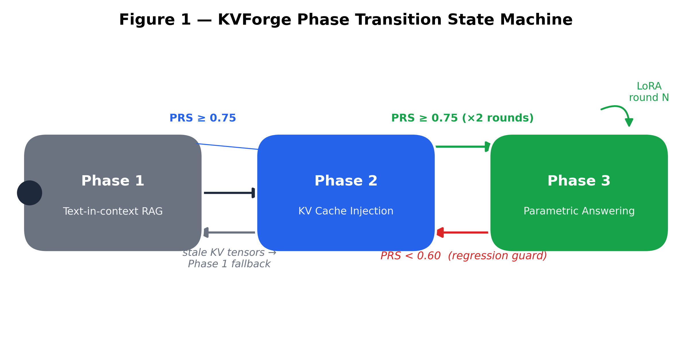
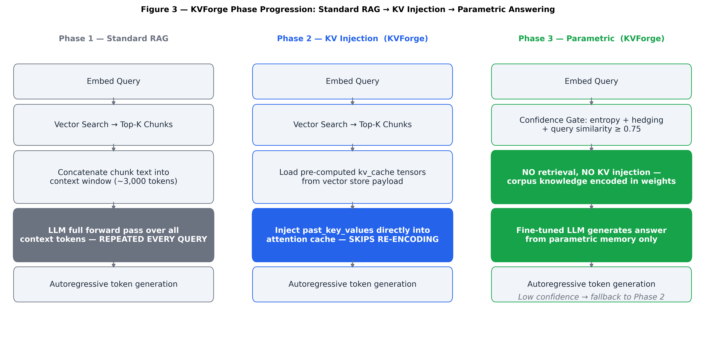
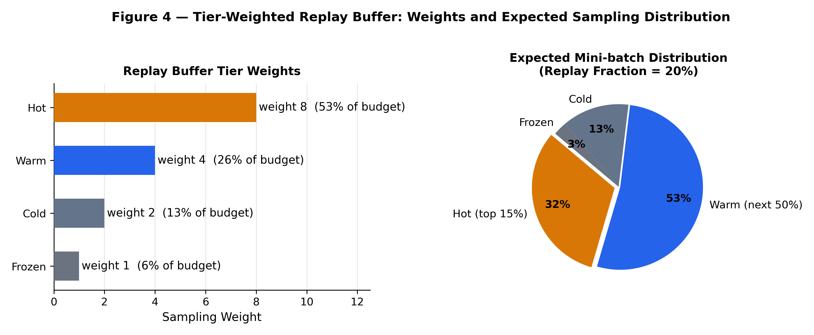
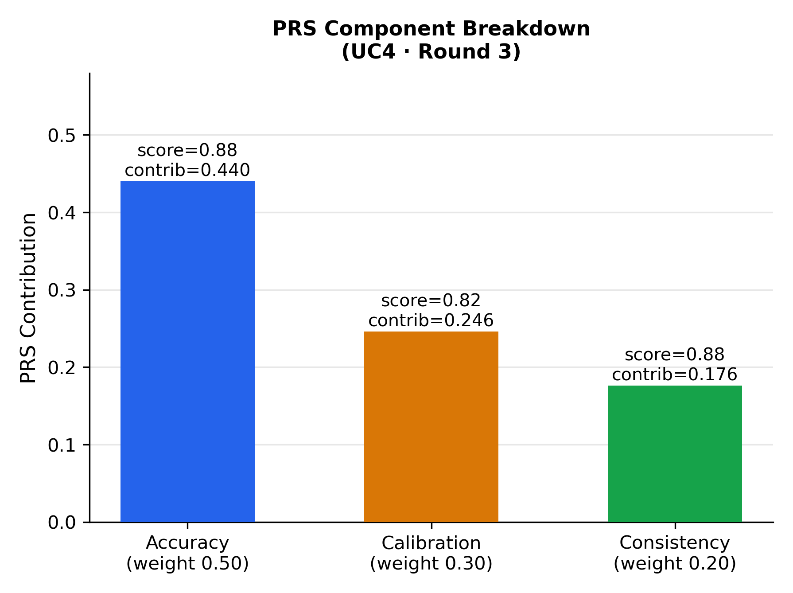
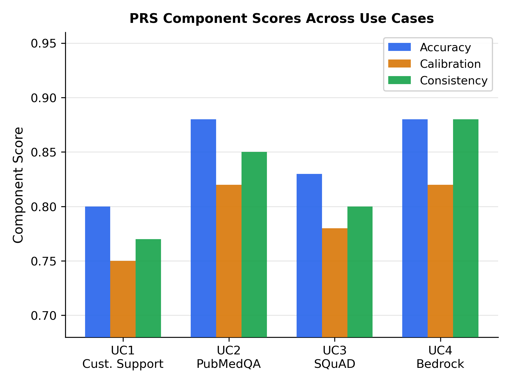
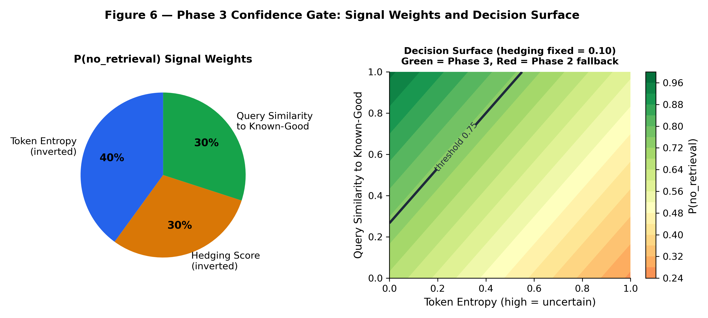
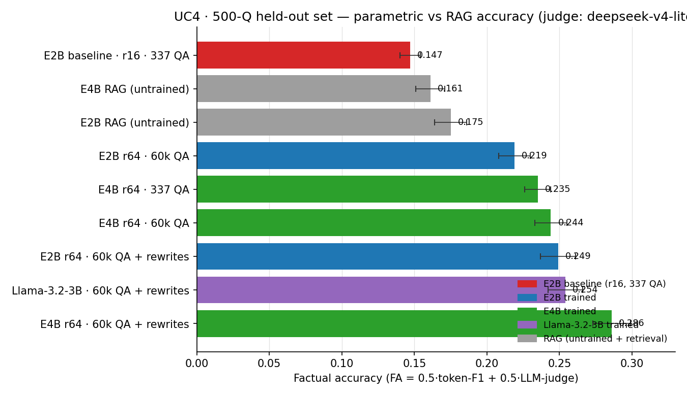
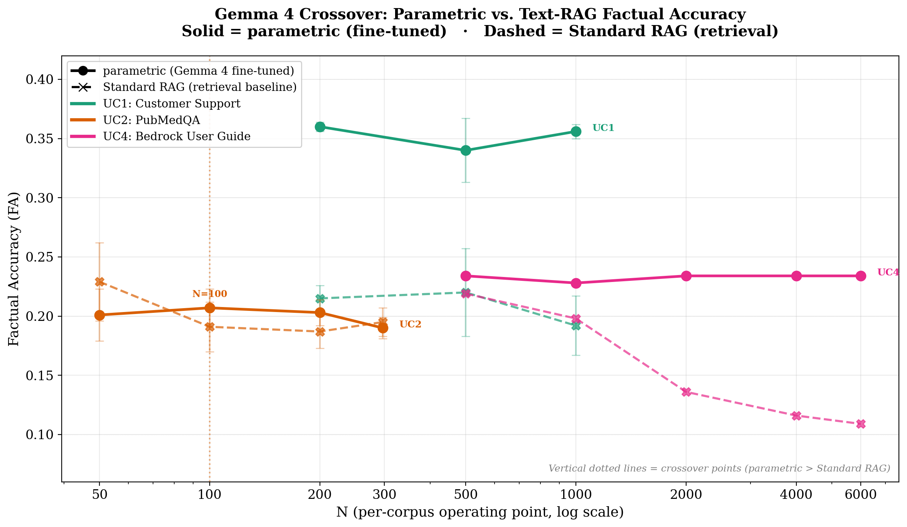

# KVForge: Progressive Parametric Absorption in Small Language Models — Why Training-Signal Diversity, Not Scale, Drives the Crossover from Retrieval to Parameters

**Dr. Hemant Joshi**  
Independent Researcher  
  
GitHub: [https://github.com/hemantcgi/kvforge](https://github.com/hemantcgi/kvforge)

> **Draft V2.** This revision re-scopes the paper around the empirical findings it can defend with the measurements already in hand, demotes unvalidated system claims to clearly-labelled status, and lists the experiments that would validate the remaining claims as explicit, currently-deferred follow-up work. A per-change map against V1 is in **Appendix A**; metric and judge provenance is in **Appendix B**. Numbers in this draft trace either to a V1 result or to a named file under `results/`.

---

## Abstract

Retrieval-Augmented Generation (RAG) grounds language-model answers in external knowledge but keeps that knowledge outside the model's weights, re-fetching and re-encoding the same context on every query. We study **progressive parametric absorption**: fine-tuning a small language model (SLM) on a corpus until it can answer an increasing share of queries *from its weights*, with retrieval retained as a fallback. Our central result is about the training signal, not the system: **diversity of the training signal, not model capacity, is the dominant lever.** In matched-rank 2×2 ablations on a 500-question held-out set (one corpus, single judge), adding diverse rewrites of source chunks to a fixed question–answer pool raises held-out factual accuracy by +0.030 to +0.042, versus a non-significant +0.009 from a 180× increase in question volume, and the effect transfers to a second architecture — a 3.2B Llama-3.2-3B reaches parity (0.254) with a 5.1B Gemma-4-E2B (0.249) on the identical recipe (comparison on total parameters; the Gemma models are ~2.3B/~4.5B *effective*). Two pre-registered, blind-judged studies sharpen the picture: among LoRA training-configuration choices, adapter **placement** (all linear layers vs. attention-only, at matched parameter budget) is the dominant retention lever (+0.067 in a two-seed blind pilot, per-fact Wilcoxon p=0.0001; +0.123 full-scale and +0.106 on leak-removed facts in a single-seed promotion), while added exposure is marginal and cross-chunk relational structure is inert; and a RAFT-trained generator **complements** retrieval precisely where retrieval fails (difference-in-differences interaction +0.135, 95% CI [+0.062, +0.206]).

These findings are produced on **KVForge**, a platform that advances an SLM-backed QA deployment through three phases — standard RAG; per-chunk KV-cache injection; and confidence-gated parametric answering — under an automatic gating heuristic. We report KVForge's engineering honestly: the parametric phase (Phase 3) is where the results above live; the KV-injection phase (Phase 2), in its current mean-pooled form, is a **characterized negative result** consistent with the KV-reuse literature, not a validated speedup. We do not claim superiority over any external system: this paper reports no head-to-head comparison under matched hardware, base model, and query set, and we scope every claim accordingly.

---

## 1. Introduction

Large language models are strong on knowledge-intensive tasks but suffer from hallucination and knowledge staleness. Retrieval-Augmented Generation [1] addresses both by supplying retrieved context at query time, decoupling the knowledge base from model parameters. Standard RAG, however, pays a re-encoding cost on *every* query: for a query retrieving five 600-token chunks, a ~2B-effective-parameter transformer executes a full forward pass over ~3,000 context tokens before emitting a single output token, every time, even for chunks retrieved thousands of times before.

This paper asks a narrower and more answerable question than "can we build a better RAG system": **under what conditions can a small language model absorb a corpus into its weights well enough to answer from parameters, and what actually controls that?** We approach it empirically, and the answer is not the one the scaling intuition predicts. Across matched-rank ablations, a cross-architecture transfer, and two pre-registered studies, the controlling variable is the *diversity and configuration of the training signal*, not model capacity.

We develop and release **KVForge** as the platform for these experiments. KVForge organizes an SLM-backed deployment into three phases:

- **Phase 1 — Standard RAG.** Retrieval; chunks rendered as text in context. No pre-computation.
- **Phase 2 — KV injection.** Pre-computed per-chunk key-value tensors are injected into the model's `past_key_values`, intended to skip re-encoding. *In its current mean-pooled form this phase is a negative result (§3.1, §5.9); we report it as such and it carries none of the paper's positive claims.*
- **Phase 3 — Parametric answering.** After LoRA fine-tuning concentrates corpus knowledge into weights, a confidence gate routes high-confidence queries to retrieval-free generation, with KV-injection/RAG as fallback.

An automatic gating heuristic (the Parametric Readiness Score, PRS; §4.7) drives phase transitions. We are explicit that **PRS is an engineering gate, not a scientific accuracy metric** — all factual claims in this paper use held-out, judge-scored metrics (§5), and we show where PRS and factual accuracy diverge rather than assuming they agree.

**Figure 1** illustrates the phase state machine.



### Contributions

Ordered by the strength of the evidence behind them:

1. **Training-signal diversity is the dominant lever for parametric absorption** (§5.3–§5.6). On a 500-question held-out set with a single fixed judge, diverse chunk-rewrites add +0.030–0.042, versus a non-significant +0.009 from a 180× increase in QA volume, and the effect transfers to a second architecture (Llama-3.2-3B reaches parity with the larger Gemma-4-E2B). Model capacity, rank-matched, is a real but secondary lever (+0.025 to +0.037).
2. **LoRA placement is the dominant training-configuration lever for parametric retention** (§5.7): a pre-registered, blind, same-session-judged study finds all-linear placement beats attention-only at matched parameter budget (+0.067 two-seed pilot, p=0.0001; +0.123 full-scale and +0.106 on leak-removed facts, single-seed), with exposure marginal and relational structure inert.
3. **Fine-tuning complements retrieval where retrieval fails** (§5.8): a pre-registered RAFT study shows the fine-tuned-plus-retrieval gain concentrates on retrieval-misses (DiD interaction +0.135, 95% CI [+0.062, +0.206]).
4. **KVForge, an open platform** for progressive parametric absorption (§4), reported with an honest engineering accounting — including a characterized negative result for mean-pooled KV injection and a corpus-dependent amortized-cost analysis (§5.9) that tempers naive latency claims.

We state plainly what this paper does **not** establish: no comparison against any external system under matched conditions; a retrieval baseline of characterized but modest quality; and strong per-corpus generality only for one corpus (§6.5).

---

## 2. Background

### 2.1 Transformer Attention and the KV Cache

Scaled dot-product attention [2] for query **Q**, key **K**, value **V** is `Attention(Q,K,V) = softmax(QKᵀ/√d_k)·V`. During autoregressive generation the model caches the **K** and **V** projections of processed tokens. For one decoder layer with *n_h* KV heads of dimension *d_h* and sequence length *L*, the cache occupies `2 × L × n_h × d_h × sizeof(dtype)` bytes. Standard RAG rebuilds this cache per query; KVForge pre-builds it per chunk at index time.

### 2.2 Low-Rank Adaptation (LoRA)

LoRA [4] adapts a frozen weight **W₀ ∈ ℝ^(d×k)** as `W = W₀ + BA`, with **B ∈ ℝ^(d×r)**, **A ∈ ℝ^(r×k)**, r ≪ min(d,k). KVForge's *default* Phase-3 adapter targets `q_proj, k_proj, v_proj`; §5.7 shows that extending placement to all linear layers (including MLP) at a matched parameter budget is the single most important configuration choice. Because adapting **K**/**V** projections invalidates stored KV tensors, each chunk carries a `kv_version` field.

### 2.3 KV Cache Quantization

Keys and values have different statistical properties — keys exhibit high inter-channel variance (favoring column-wise quantization), values smoother distributions (favoring group quantization) [18, 19].

### 2.4 Retrieval-Augmented Generation

Lewis et al. [1] combined a non-parametric index with a parametric generator. KVForge's distinct position is to progressively *eliminate* retrieval for queries the model has absorbed, while retaining it as a fallback.

---

## 3. Related Work

### 3.1 KV Cache Reuse, Prefix Caching, and Why Phase 2 Is a Known-Negative

**PromptCache** [6] reuses KV across queries sharing a prompt prefix; it is session-scoped and lost on restart. **PagedAttention/vLLM** [3] manage KV memory within a server process. **SGLang** [7] gives a radix-tree prefix cache for shared prompts. These target prompt-prefix sharing; KVForge's Phase 2 targets independent document chunks that share no prefix.

**TurboRAG** [34] is the closest published system to Phase 2: it precomputes and stores per-chunk KV caches offline and retrieves them to skip prefill. Critically, TurboRAG's own analysis shows that naively concatenating independently-precomputed per-chunk KV produces an inconsistent attention mask and position IDs relative to a true joint prefill, and corrects this with an explicit independent attention mask *and* targeted fine-tuning (up to 9.4×, average 8.6× TTFT reduction, "comparable performance"). **APE** [38] independently confirms that parallel-encoding independently-cached segments causes "a significant performance drop" absent shared-prefix design plus adaptive-temperature and attention-scaling corrections. **CacheBlend** [20] fuses multiple non-prefix KV caches by selectively recomputing the ~10–15% highest-deviation tokens (2.2–3.3× TTFT, quality within ≤0.02 F1/ROUGE-L). **RAGCache** [39], **EPIC** [35], and **Block-Attention** address serving-layer position-independent caching.

KVForge's Phase 2 applies **none** of these corrections — it injects mean-pooled (or full-token) KV into `past_key_values` with no attention-mask or position-ID realignment and no compensating fine-tuning. We therefore treat Phase 2's current design as a **known-negative baseline going in**, not a contribution: the realignment/fine-tuning fixes above are the open engineering task Phase 2 has not implemented, and §5.9 reports its status accordingly.

**Mean-pooled KV injection specifically is unsupported by the KV-merging literature.** That field merges only a few similar/adjacent tokens with *weighted* schemes: **CaM** [40] reports perturbation escalating with compression; **KeepKV** [42] avoids direct averaging; **KVMerger** [41] merges only similar clusters. The one literal mean-pool precedent, **GQA** [43], pools across the *head* dimension and requires ~5% uptraining to recover quality. No source supports a *frozen* transformer attending usefully to a single mean-pooled per-layer vector it never trained on. KVForge's V1 mean-pool scheme is exactly this unsupported case; we present it as a diagnostic of why naive pooling fails.

**Durable KV storage is also not novel.** **CachedAttention/AttentionStore** [36], **Mooncake** [37], and **LMCache** [33] all persist KV across tiers. We therefore do **not** claim "first durable KV store." The narrower, defensible architectural distinction is co-locating per-chunk KV *inside the same vector-database record as the chunk's embedding* and coupling that with an automatic PRS-gated three-phase progression — a modest distinction, scoped as such throughout. **LMCache** [33] (persistent tiered KV offload, CacheBlend fusion; vendor-reported 1.9–8.1× TTFT, 2.3–14× throughput on 8×H100) is the nearest production analog to Phase 2; like KVForge it has no parametric tier, but unlike KVForge it implements fusion correctly.

### 3.2 RAG Systems and Dense Retrieval

**DPR** [5] (dual encoders), **ColBERT** [17] (late interaction), **RETRO** [8] (index-time chunk encodings), **FiD** [21] (independent passage encoding, decoder fusion). KVForge extends the pre-computation direction by storing KV tensors rather than encoder states, for any decoder-only model, and adds the progressive design.

### 3.3 LoRA and PEFT

**QLoRA** [9] enables 4-bit quantized LoRA; KVForge uses `bitsandbytes` NF4. Continual LoRA risks catastrophic forgetting [13]; KVForge's tier-weighted replay buffer (hot chunks 8× weight) is a lightweight proxy for Elastic Weight Consolidation [22].

### 3.4 Calibration and Uncertainty

**Guo et al.** [10] (temperature scaling), **Self-Consistency** [11], **Semantic Entropy** [12]. KVForge's PRS uses a lighter self-report + three-sample-consistency proxy; §4.7 and §5 treat PRS as a gate, not a calibrated accuracy estimate.

### 3.5 KV Cache Compression

**KVQuant** [18], **KIVI** [19], **QJL** [23].

### 3.6 Continual Learning

Replay-based methods dominate practical continual learning [24]; KVForge's tier signal (retrieval frequency) is a domain-specific prioritization unavailable to general methods.

### 3.7 Cache-Augmented Generation

**CAG** [25] preloads a bounded knowledge base into context and precomputes one global KV cache, answering with no retrieval — closest to KVForge's overall premise, but defined only for corpora that fit a single context window. KVForge targets the complementary large-corpus regime (UC1–UC4: 2,000–2,918 chunks) via per-chunk storage and per-chunk staleness tracking. The two have **not** been measured against each other under a shared corpus size — a comparison we flag as valuable future work (§6.5).

### 3.8 Retrieval-Augmented Fine-Tuning and Parametric RAG

**RAFT** [26] fine-tunes a model to use retrieved context (with distractors) and still retrieves at every query. **Parametric RAG** (Su et al. [27]) encodes evidence into trainable parameters; a re-examination by Tang et al. [44] finds parametric encoding does not consistently beat token-based RAG and that a hybrid wins — directly supporting KVForge's choice to *gate* between parametric and retrieval rather than eliminate retrieval. §5.8 tests this complementarity directly.

### 3.9 Knowledge Editing

**ROME** [28] and **MEMIT** [29] perform surgical closed-form edits at mid-layer MLPs for discrete factual triples (CounterFact-style). KVForge's LoRA-plus-replay loop adapts to open-ended corpus text and is evaluated end-to-end; neither editing line has a retrieval-fallback confidence gate.

### 3.10 Confidence-Gated Adaptive Retrieval

**Self-RAG** [30] (reflection tokens), **SKR** [31] (self-knowledge), **Adaptive-RAG** [32] (complexity classifier) all decide per-query among retrieval strategies, but none fall back to a KV-injection tier or use a composite calibration-and-consistency gate. Whether KVForge's composite gate is more reliable than these single-signal gates is **not measured here** and would require running all gates on one base model and corpus.

---

## 4. The KVForge Platform

### 4.1 Architecture Overview

Pipeline sequence:

- **Phase 1:** Index → KV pre-compute
- **Phase 2:** Sleep-time FAQ gen → LoRA train → KV recompute → PRS eval
- **Phase 3:** LoRA train (round 2) → KV recompute → PRS eval

Each PRS eval closes a loop: if the gate threshold is unmet, the system generates more FAQs and trains another round. State is stored atomically per corpus in `version.json` (temp-file rename):

```json
{
  "current_lora_version": 4,
  "checkpoint_path": "lora_checkpoints/v4/",
  "phase": 3,
  "prs_history": [{"round": 1, "prs": 0.727}, {"round": 2, "prs": 0.783}, {"round": 3, "prs": 0.863}],
  "known_good_queries": [...]
}
```

### 4.2 Indexing and KV Pre-computation

Each chunk is (1) embedded (default BAAI/bge-small-en-v1.5, 384-dim; UC4: mixedbread-ai/mxbai-embed-large-v1, 1024-dim) and upserted with payload `{text, page, source_file, access_count, kv_version, tier}`; then (2) tokenized (≤512 tokens) and passed through the LLM to materialize `past_key_values`. Per-layer tensors `[1, n_kv_heads, seq_len, head_dim]` are mean-pooled over the sequence dimension, stacked to `[L, 2, H, d_h]`, serialized to float16, and stored base64 in the payload. For Gemma-4-E2B (35 layers, 1 KV head, head_dim 256): `35 × 2 × 1 × 256 × 2 = 35,840 bytes ≈ 36 KB/chunk`; ~90 MB for UC4's 2,520 chunks. *The mean-pool step is the source of the Phase-2 negative result (§3.1, §5.9).*

### 4.3 Query-Time Inference: Phase 1 vs Phase 2



At query time the module (1) embeds the query, retrieves top-K; (2) compares each chunk's `kv_version` to `current_lora_version`; (3) if **all** fresh, injects KV; (4) if **any** stale, falls back to Phase-1 RAG for the whole query and enqueues stale chunks for background recompute. The all-or-nothing rule prevents mixing tensors across LoRA versions.

### 4.4 Sleep-Time FAQ Generation

Before each LoRA round, `sleep_faq_generator` queries a cloud LLM (Gemini 2.5 Flash, Claude, or GPT-4.1) for N diverse QA pairs per chunk — sleep-time compute [14]. With tier weighting, ~50% of a 50-question budget targets the top-15% hot chunks.

### 4.5 Tier-Weighted Replay Buffer



| Tier | Condition | Replay weight |
|------|-----------|:---:|
| hot | Top 15% by access count, accessed < 7 days | 8 |
| warm | Next 50%, accessed < 30 days | 4 |
| cold | Remaining accessed chunks | 2 |
| frozen | Never accessed | 1 |

The SQLite buffer evicts lowest-tier/oldest entries past a 5,000-chunk cap. **Note:** all V1 factual experiments were run at `tier=frozen` (uniform weighting); the tier system's *quality* effect is therefore not evaluated here and is deferred.

### 4.6 LoRA Fine-Tuning Loop

Default config: targets `q_proj/k_proj/v_proj` (but see §5.7 — all-linear is better), r=16/α=32, 4-bit NF4 (QLoRA [9]), 20% replay fraction, 3 epochs/round. After training, `kv_version` increments, invalidating stored KV and triggering tier-ordered recompute (hot chunks first, ~76 s).

### 4.7 Parametric Readiness Score (PRS) — an Engineering Gate, Not an Accuracy Metric

PRS gates autonomous phase advancement:

```
PRS = 0.5 × accuracy_ratio + 0.3 × calibration + 0.2 × consistency
```

- **accuracy_ratio** = `min( sim(param_ans, gt) / (sim(rag_ans, gt) + ε), 1.0 )` — cosine-based, *relative* to the RAG answer.
- **calibration** = `1 − |self_confidence_norm − sim(param_ans, gt)|`.
- **consistency** = mean pairwise cosine over three samples at T=0.7.





**Thresholds (matching the implementation in `core/version.py`).** The system advances Phase 1→2 when PRS first reaches **0.75**, and Phase 2→3 when PRS holds **≥ 0.75 for two consecutive rounds**; a regression guard reverts to Phase 2 if PRS falls **below 0.60** across the stability window. (V1 of this paper reported 0.80/0.75; those values did not match the code and are corrected here.)

**Critical caveat.** PRS is a cosine-based *readiness heuristic*, not a factual-accuracy guarantee. We do **not** present PRS as a scientific accuracy metric, and §5 shows exactly where PRS (cosine, §5.2) and judge-scored factual accuracy (§5.3+) diverge. Validating whether PRS correlates with held-out factual accuracy — and, if not, replacing its accuracy term with a judge-scored one — is listed as follow-up work (§6.5). After each round, FAQs with `accuracy_ratio ≥ 0.85` seed `known_good_queries` for the Phase-3 gate.

### 4.8 Phase 3 Confidence Gate



Three lightweight signals — token entropy, hedging-phrase detection, and query similarity to known-good queries — route high-confidence queries to parametric generation (default threshold 0.75), else fall back. Lower thresholds raise Phase-3 utilization at higher hallucination risk; the gate should not rely on self-reported confidence alone in production.

---

## 5. Experimental Evaluation

**Reading guide.** This section leads with the paper's strongest evidence — the training-signal and configuration studies on UC4 at n=500 with a single fixed judge (§5.3–§5.8) — then reports the broader but weaker cross-corpus crossover (§5.10) and the Phase-2 negative result (§5.9) honestly. **Metrics are not interchangeable across subsections**: three metric families appear (cosine-PRS; `deepseek`-judged factual accuracy, FA; blind coverage@0.5) across the two evaluation regimes of §5.2, on different scales and judges, and only within-subsection, within-judge deltas are meaningful. Appendix B enumerates all five metric×judge pairings.

### 5.1 Setup

Experiments run on a single four-GPU host (4× NVIDIA A10G, 24 GB each), Ubuntu 22.04, CUDA 12.1, PyTorch 2.1, Transformers 4.40; vector store Qdrant 1.9. Base models: **Gemma-4-E2B-it** (5.1B total / ~2.3B effective) and its sibling **Gemma-4-E4B-it** (7.49B total / ~4.5B effective); the architecture-transfer arm uses **Llama-3.2-3B-Instruct** (3.2B). Embeddings: bge-small-en-v1.5 (UC1–UC3), mxbai-embed-large-v1 (UC4). LoRA defaults r=16/α=32 (per-experiment ranks stated inline). **Base model per experiment family.** The data-lever ablations (§5.3) label E2B or E4B per table row; the placement and RAFT studies (§5.7–§5.8) use **Gemma-4-E2B**; the architecture-transfer arm (§5.6) uses **Llama-3.2-3B**. The cosine-PRS readiness figures (the `version.json` example in §4.1 and the 0.755–0.863 spread in §6.2) were produced on **Gemma-4-E4B**. We flag a reproducibility caveat here: the original run logs for those early PRS experiments are no longer available, so that base-model attribution is the authors' record rather than a log-verified fact (§6.5). The four-corpus crossover table (§5.10) used the Gemma-4 family; which variant (E2B or E4B) is not confirmed in the surviving records, so we do not specify it.

### 5.2 Datasets and the Two Evaluation Regimes

Four corpora: **UC1** customer support (Bitext, 2,000 chunks), **UC2** PubMedQA [15] (2,918), **UC3** SQuAD 2.0 [16] (2,000), **UC4** Amazon Bedrock User Guide (2,520; expanded 6,154-chunk index for the n=500 work). Two evaluation regimes are used and must not be conflated:

- **PRS (cosine) — readiness heuristic** — the gating heuristic of §4.7.
- **Held-out factual accuracy (FA), judge-scored** — the scientific metric. The primary, best-powered FA evaluation is a **500-question UC4 held-out set** under a single judge (`deepseek-v4-lite` via CodeVector), with reported standard errors.

### 5.3 The Data Lever: Diverse Rewrites Beat QA Volume and Capacity (UC4, n=500)

The central question is what controls parametric absorption. We fix the held-out set (500 UC4 questions), the judge (`deepseek-v4-lite`), and the generation budget (adaptive ≈30–40 tokens; see §5.3.1), and vary base model (E2B/E4B/Llama), adapter rank, QA volume, and the presence of diverse chunk-rewrites. We also add, per model, a **Standard-RAG baseline** (untrained base model + Qdrant top-5 over the 6,154-chunk index) to establish the Phase-1 ceiling each trained arm must beat.

| Model | Training signal | FA (n=500) | Latency p50 (s) |
|-------|-----------------|-----------:|----------------:|
| E2B | RAG (untrained) | 0.175 ± 0.011 | 3.19 |
| E4B | RAG (untrained) | 0.161 ± 0.010 | 3.48 |
| E2B | r16, 337 QA | 0.147 ± 0.007 | 3.92 |
| E4B | r64, 337 QA | 0.235 ± 0.009 | 2.99 |
| E2B | r64, 60k QA | 0.219 ± 0.011 | 1.23 |
| E2B | r64, 60k QA + rewrites | 0.249 ± 0.012 | 1.31 |
| E4B | r64, 60k QA | 0.244 ± 0.011 | 1.55 |
| E4B | r64, 60k QA + rewrites | **0.286** (mean; checkpoints 0.275–0.302) | 1.64 |



Four findings:

- **Rewrites are the active lever.** At matched r=64 and 60k QA, adding 61,554 diverse rewrites lifts FA by **+0.030 (E2B: 0.219→0.249)** and **+0.042 (E4B: 0.244→0.286)** — while the entire QA-volume effect is a non-significant +0.009. E2B-with-rewrites (0.249) reaches the *larger* model's QA-only level (0.244).
- **QA volume is nearly inert.** Raising E4B QA from 337 to 60,209 (no rewrites) moves FA +0.009 (0.235→0.244), within noise.
- **Capacity, rank-matched, is modest.** E2B→E4B gains +0.025 (QA-only) and +0.037 (with rewrites). The naive E2B→E4B gap of +0.088 read directly from the table conflates capacity with adapter rank (E2B r16 vs E4B r64); moving E2B from r16 to r64 (0.147→0.219) alone recovers +0.072, of which ≤0.009 is QA volume. **Rank matching is essential** — without it, "capacity" is overstated ~3×.
- **The learning curve plateaus early.** Across six checkpoints of the E4B+rewrites run FA is 0.278, 0.275, 0.288, 0.280, 0.302, 0.295 — flat-to-slightly-rising, realized well before the corpus is consumed.

**Headline-number convention.** We report the E4B+rewrites result as its **six-checkpoint mean, 0.286**, not the best single checkpoint (0.302). Because checkpoints were scored on the evaluation set, reporting the max would be test-set selection; where a single number is needed we use the mean (0.286) or the final checkpoint (0.295), stated explicitly.

#### 5.3.1 Corrected generation budget

The earlier n=89 evaluations (§5.5) ran `_generate_parametric` at a fixed `max_new_tokens=256`, ignoring the harness's adaptive budget; open-ended questions rambled to 256 tokens, slowing evaluation ~5× and deflating token-F1 (a correct fact buried in 200 words scores near zero against a 10-word reference). Passing the adaptive budget (≈30–40 tokens) dropped answer length to 7.7–26 words. **This shifts absolute FA**, so n=500 values are not comparable to the n=89 figures of §5.5 — only within-regime deltas are interpreted.

### 5.4 The Held-Out Set and Its Residual Leak (a bias we quantify, not hide)

The 500-question set was built by sampling 795 chunks evenly across the 6,154-chunk UC4 corpus and generating one short (≤30-word), fact-grounded QA pair per chunk with `deepseekv4p`, then deduplicating against both the 89-question set *and* the 60,209 training pairs. **Dedup criterion:** exact normalized-question and normalized-answer match plus token-set Jaccard ≥ 0.80 for near-duplicate *questions*, retaining 500 pairs with zero exact question/answer overlap across 500 distinct source chunks. Answer-level dedup was essential: seeding the generator on training chunks reproduced a training item verbatim on the first probe, so question-only filtering would have leaked facts.

**Residual leak and its direction.** Exact/Jaccard-0.80 dedup does **not** remove paraphrastic fact overlap. In the independent placement study (§5.7), splitting its 481-fact probe set by whether a near-duplicate appears in the 60k QA finds **15.6% leaked** (the one directly-measured figure); substring-level overlap below the Jaccard-0.80 threshold is plausibly higher but is not measured here. Leakage favors the *trained* arm over the *untrained RAG* baseline, so the §5.3 trained-vs-RAG margins are **upper bounds**: at least ~0.156 of facts reflect recall of near-seen pairs rather than generalization. §5.7 shows the placement effect survives leak removal (below); we have **not** re-run the §5.3 trained-vs-RAG comparison on a leak-removed subset, and flag it as CPU-feasible follow-up (Appendix A).

### 5.5 Smaller-Sample Precursors (n=89) — Reported for Continuity Only

The n=89 UC4 evaluations that motivated the n=500 work: the E2B→E4B scale-up gave +0.035 FA (t=1.66, p≈0.05, under-powered), and the diverse-corpus arm reached 0.235 vs 0.155 (E4B QA-only) / 0.120 (E2B). These are superseded by §5.3 (5.6× the sample size, corrected generation) and are retained only to document the trajectory; their absolute values are not comparable to §5.3.

### 5.6 Architecture Transfer: The Rewrite Lever on a Second Family (Single Seed)

To test whether the rewrite lever is Gemma-specific, we ran the identical recipe (r=64, 1 epoch, 60,209 QA + 61,554 rewrites) on **Llama-3.2-3B-Instruct** (a different family, *smaller* than both Gemma arms), same 500-question set, same judge.

| Model | Params | FA (n=500) | token-F1 | LLM-judge | Latency p50 (s) |
|-------|---:|---:|---:|---:|---:|
| gemma-4-E4B-it | 7.49B | 0.286 (0.275–0.302) | 0.314 | 0.259 | 1.64 |
| **Llama-3.2-3B-Instruct** | **3.2B** | **0.254 ± 0.012** | **0.312** | **0.196** | **1.47** |
| gemma-4-E2B-it | 5.1B | 0.249 ± 0.012 | 0.290 | 0.208 | 1.31 |

Llama-3.2-3B (3.2B) reaches **0.254**, slightly above the 5.1B E2B (0.249) and within ~0.03 of E4B. **We state this as "the rewrite lever transfers to a second architecture," not "architecture-agnostic":** it is a single-seed result on one additional family, and generalizing beyond that requires more seeds and families (Appendix A). It does establish that a 2.3× *total*-parameter range (3.2B→7.49B) separates only 0.249–0.286 FA at matched recipe — reinforcing data-diversity over scale. (We frame the Llama-vs-Gemma parity on total parameters; on *effective* parameters the 3.2B dense Llama is larger than E2B's ~2.3B, so the parity claim is a total-parameter statement, not an effective-parameter one.)

### 5.7 Training-Configuration Levers: Placement, Exposure, Structure (Pre-Registered)

We next ask which *training-configuration* levers move pure-parametric fact retention, under a pre-registered design that fixes the decision rule before each run. Metric: `coverage@0.5 = (CORRECT+PARTIAL)/481` on 481 held-out single-fact probes. Treatment and control predictions are shuffled into one shard and scored **blind, in the same judging session**, removing the ~0.03 cross-session judge drift that inflated an early non-blind estimate. **Only within-session treatment−control deltas are interpreted** (the rubric differs from §5.3's FA and drifts between sessions). Pre-registered bands: WORKS if Δ≥+0.040 and χ²≥3.84; DEAD if Δ≤+0.012; else AMBIGUOUS → paired second seed.

**(B) Placement works and dominates.** All-linear placement (r=8, α=16; 12.1M trainable) vs. attention-only `q/k/v` (r=64; 12.48M — matched budget) raised coverage 0.250→0.316, **Δ=+0.067** across two paired seeds (per-fact Wilcoxon z=3.92, p=0.0001). Promoted to the full 60,209-QA-from-base regime and co-judged blind against the `q/k/v` r=64 incumbent on identical data: **0.462 vs 0.339, Δ=+0.123** (McNemar χ²=29.25, p<0.0001).

| Placement contrast | control | treatment | Δ | test |
|---|---:|---:|---:|---|
| Pilot (2-seed, blind) | 0.250 | 0.316 | **+0.067** | Wilcoxon p=0.0001 |
| Full scale (60k from base, single-seed) | 0.339 | 0.462 | **+0.123** | McNemar χ²=29.25, p<0.0001 |

**Not a memorization artifact.** Splitting the 481 facts by leak (15.6% leaked), the gain holds on the **non-leaked** subset (n=406, **Δ=+0.106**) and is larger on the leaked subset (n=75, Δ=+0.213) — placement improves genuine generalization. (The full-scale +0.123 is a single-seed, descriptive promotion outcome in a different regime/judge from the pilot, not evidence the effect "scales with data.")

**(A) Exposure is marginal.** Three epochs vs. one landed at **Δ=+0.0405** (two paired seeds; pooled McNemar χ²=7.11, p<0.01) — barely clearing the WORKS line, far below placement.

**(C) Relational structure is dead.** A first relational run appeared to hurt (Δ=−0.071) but was confounded three ways (256-token truncation dropping 14.3% of relational tokens; fewer optimizer steps; unmatched singleton controls). A clean re-run (512-token cap, step-matched via gradient accumulation, 74 identical-text singletons) did not replicate the deficit: **C1 0.231 vs C0 0.256, Δ=−0.025, n.s.** A difference-in-differences subtracting the identical-text singleton gap isolates the structure-specific effect at **+0.002 ≈ 0**. Cross-chunk relational linking adds essentially nothing over plain paraphrase.

**Scoreboard:** placement dominates (+0.123 full-scale, +0.106 non-leaked), exposure marginal (+0.040), structure inert. This protocol carries **no judged RAG arm** (its only retrieval number, recall@5=0.586, is a retrieval metric, not an answer score), so whether this parametric recall sits above or below a retrieval ceiling is answered next.

### 5.8 FT + RAG Complementarity via RAFT (Pre-Registered, Confirmed)

Does a fine-tuned generator *complement* retrieval rather than duplicate it? Following RAFT [26], a generator is trained on `(question, context = oracle + distractors, answer)` with the oracle withheld on a fraction to force parametric fallback (effective oracle-in-context ≈0.56; oracle recovered by verbatim-then-overlap matching, hand-validated 90% precision). All arms use one shared prompt, a 48-token cap, and raw top-5 retrieval. "Retrieval hit" ≡ gold chunk ∈ top-5 ≡ **290/481 facts (0.603)** under this protocol — reported *separately* from §5.7's recall@5=0.586 (different protocol). Arms: R0 base+top-5; R1 all-linear-QA FT+top-5; R2 RAFT FT+top-5; R3 RAFT closed-book; R1cb plain-QA FT closed-book. Pre-registered discriminating test: complementarity predicts the R2-over-R0 gain concentrates on retrieval-misses (a DiD interaction).

| Arm | generator | coverage@0.5 (all) | hit (n=290) | miss (n=191) |
|---|---|---:|---:|---:|
| R0 | base + top-5 RAG | 0.728 | 0.934 | 0.414 |
| R1 | plain-QA FT + top-5 RAG | 0.730 | 0.834 | 0.571 |
| **R2** | **RAFT FT + top-5 RAG** | **0.809** | **0.962** | **0.576** |
| R3 | RAFT, closed-book | 0.462 | 0.455 | 0.471 |
| R1cb | plain-QA FT, closed-book | 0.528 | 0.521 | 0.539 |

**Primary (pre-registered) — confirmed.** R2 beats plain RAG, **0.809 vs 0.728, Δ=+0.081** (McNemar χ²=22.2, p≈0; Wilcoxon p=1.5×10⁻⁷). The gain concentrates on misses exactly as predicted: Δ_hit=+0.028, Δ_miss=+0.162; the DiD interaction **Δ_miss−Δ_hit=+0.135**, stratified-bootstrap 95% CI **[+0.062, +0.206]** (p=3×10⁻⁴), excluding zero. On the leak-removed clean subset (n=406) it holds at **Δ=+0.071** (McNemar χ²=14.8, p<10⁻⁴), and the DiD lower CI (0.062) exceeds the ~0.038 worst-case recovery-artifact bound.

**Mechanism — parametric fallback, tested directly.** Among the 112 misses the base fails, the RAFT model answers closed-book (R3) on **68% of the 38 facts R2 rescues** but only **24% of the 74 it still fails** — a ~3× enrichment, not better distractor-reading (only 2 of 38 rescued facts had the gold answer in a non-gold retrieved chunk).

**What RAFT uniquely adds (exploratory, post-hoc).** Comparing R2 to R1 (both FT on the same 60k): the miss-side knowledge is *not* RAFT-specific (R1 already 0.571 ≈ R2's 0.576) — it comes from the 60k. What plain-QA FT *also* does is interfere with grounded reading (R1 drops R0's 0.934→0.834 on hits); the RAFT objective removes that interference (R2 restores hits to 0.962). Read this way, RAFT's distinctive value against a FT-and-retrieving baseline is *keeping fine-tuning from degrading use of the retrieved passage*, not injecting knowledge. Caveats keep this exploratory: R1+top-5 is itself length-OOD, and the arms are not exactly matched (R2 dropped 3,258 long packed examples).

**Validity.** All five arms judged blind in one session (481×5 → 1,967 unique judgments; zero blindness breaches on audit). Session-to-session rubric drift measured here at +0.067 on byte-identical R1cb text, so absolute coverage is session-relative; only within-session deltas are interpreted.

### 5.9 Phase 2 (KV Injection): A Characterized Negative Result

We report Phase 2's status plainly. The mean-pool injection scheme (§4.2) is, by the analysis of §3.1 (TurboRAG, APE, CacheBlend, CaM/GQA), expected to degrade quality without position/attention realignment or compensating fine-tuning, none of which Phase 2 implements. Consistent with that, Phase-2 factual quality was spot-checked on only UC3 and UC4 and is **not** reported as a validated speedup; the parametric crossover of §5.10 is measured against **Standard RAG (Phase 1)** and does **not** depend on Phase 2. We therefore remove Phase 2 from the system's value proposition in this revision. Implementing a cited correction (independent attention mask + position-ID realignment, à la TurboRAG/APE) and measuring whether Phase 2 can reach Standard-RAG quality at a real matched-workload speedup is the single highest-value follow-up to convert this negative result into a positive one (§6.5).

### 5.10 Cross-Corpus Crossover (Preliminary: Small-N, Single-Seed, Earlier Judge)

The strongest results above are UC4-only. To gauge breadth we report the earlier four-corpus crossover study — but flag its weaker footing: single seed, small held-out sets (n=76/50–297/200/89), and an earlier judge (`deepseek-v4-flash`, now unreachable) **not comparable** to §5.3's `deepseek-v4-lite`. These numbers are **preliminary evidence of breadth, not a validated cross-corpus claim.**

| Corpus | N (operating point) | RAG FA | Param FA | Crossover |
|--------|---:|:---:|:---:|:---:|
| UC1 Customer Support | 200 | 0.215 | 0.360 | yes |
| UC1 | 1000 | 0.192 | 0.356 | yes* |
| UC2 PubMedQA | 50 | 0.229 | 0.201 | no |
| UC2 | 100 | 0.191 | 0.207 | yes (borderline) |
| UC2 | 297 | 0.195 | 0.190 | borderline* |
| UC3 SQuAD 2.0 | 500 | 0.144 | 0.221 | yes |
| UC3 | 2000 | 0.163 | 0.221 | yes* |
| UC4 Bedrock | 500 | 0.219 | 0.234 | yes |
| UC4 | 6000 | 0.109 | 0.234 | yes* |

(* = each dataset's highest N; N is a per-corpus operating point, not a training-QA-volume axis.) On UC4 the margin widens as Standard-RAG FA declines at larger N (0.22→0.11) while parametric holds ~0.23. **But** UC2's crossover stays within 0.02 FA (noise), and FA is modest throughout (0.11–0.36), so crossover denotes *relative* superiority over a baseline whose own held-out FA is low — see §5.11. We now treat UC1/UC2/UC3 crossover as suggestive pending the same n=500, single-judge, seeded treatment UC4 received.



### 5.11 On the Retrieval Baseline (M1)

The crossover and trained-vs-RAG comparisons are only as meaningful as the retrieval baseline is competent. We characterize it from existing measurements rather than assert it: top-5 retrieval recovers the gold chunk for **0.603** of UC4 facts (§5.8 protocol) and recall@5 = **0.586** (§5.7 protocol); untrained-base-model RAG FA is **0.161–0.175** (§5.3). These are *modest*, and we do not claim the baseline is strongly tuned — no chunk-size/top-k/reader-prompt sweep was run. Consequently, "parametric overtakes retrieval" should be read as **superiority over a retrieval baseline of characterized, modest quality**, not over a competitively-tuned RAG system. Producing a tuned RAG baseline (chunking/top-k/reader sweep) under matched conditions is a primary validation step (§6.5); it was not run under this revision's compute constraints.

### 5.12 Pipeline Timing (UC4 Reference Run)

| Step | Duration |
|------|:--------:|
| Chunk + embed + upsert (2,520 chunks) | ~45 s |
| KV tensor computation (0.20 s/chunk) | ~498 s |
| LoRA training (3 epochs, 474 steps) | (step-bound) |
| KV recompute after adapter update | ~510 s |
| PRS evaluation (50 FAQs) | ~90 s |
| **Total (one round)** | **~20 min** |

Indexing is dominated by KV pre-computation (one forward pass per chunk). Every LoRA update invalidates all stored KV; full recompute adds ~8.5 min to a ~20-min round (42% overhead), mitigated by tier-ordered recompute (hot chunks first, ~76 s).

### 5.13 Amortized Cost — Latency Does Not Imply Cheaper (M6)

V1 summarized Phase 3 as "2–3× faster." Two corrections are warranted. **(i) The wall-clock latency gap (§5.3: parametric p50 1.2–1.6 s vs RAG 3.2–3.5 s; p95 ≈2.7–3.8 s vs ≈30 s) is confounded by output length:** parametric arms used a short generation cap while the RAG baseline generated long answers, so the p95≈30 s RAG tail reflects generation length, not retrieval. A matched-output-budget latency comparison was not run (compute-constrained) and is required to attribute the gap to architecture. **(ii) Lower per-query latency does not translate to lower cost except at high volume on favorable corpora.** From the amortized cost model (`results/exp1/uc4_costmodel_measured.json`, `uc1_costmodel_measured.json`; A10G at $1.006/GPU-hr, KV cost included):

| Corpus | Parametric $/query | Plain-RAG $/query | Break-even vs plain RAG | Break-even vs *measured* prefix-cached RAG |
|---|---:|---:|---:|:---:|
| UC4 | 2.33 × 10⁻⁵ | 6.31 × 10⁻⁵ | **~35,149 queries** | **~36k–140k queries** (repeat-rate dependent) |
| UC1 | 6.78 × 10⁻⁵ | 4.67 × 10⁻⁵ | **never** | **never** |

For UC4, parametric answering is cheaper per query but only amortizes its one-time training/recompute cost (~$1.42 index-time; `par_one_time_s≈5068`) after **~35k queries** vs. plain RAG; its cost per 1M queries falls from $1,440 (at 1k lifetime queries) to $25 (at 1M) vs. plain RAG's roughly flat ~$63–80. Against a *prefix-cached* RAG baseline the picture is corpus- and repeat-rate-dependent: using the file's **measured** cached costs (`vs_prefix_cached_rag_measured`), UC4 parametric still breaks even, but only beyond **~36,191 queries** (low query-repeat, α=0.0) rising to **~139,733** (high-repeat, α=1.2), while UC1 **never** breaks even against cached RAG at any measured repeat rate (its per-query parametric cost 6.78×10⁻⁵ exceeds every measured cached cost). (The files also carry an *idealized* flag `parametric_can_beat_cached_rag=false`, but that rests on a proxy the file itself flags for direct measurement — it sets cached-repeat cost equal to the parametric per-query cost by construction — so we report the measured break-even above instead.) **The honest economic claim is therefore corpus- and volume-dependent amortization, not a blanket speedup/cost win:** parametric absorption pays for itself at high query volume on favorable-structure corpora (UC4) and does not on others (UC1).

### 5.14 Operational Comparison (Characterization, Not a Benchmark)

| Dimension | Std. RAG | KVForge Phase 3 |
|-----------|:---:|:---:|
| Re-encoding | Always | Never (parametric path) |
| Updatable | Yes | Yes (recompute) |
| OOD queries | Yes | Yes (gated fallback) |
| GPU at inference | Yes | Potentially no |
| Training | No | Yes (~20 min/round) |

Phase 3 answers a self-selected, confidence-gated subset, so this table characterizes pipeline behavior, not a matched head-to-head benchmark (§6.5). The PRS "readiness" row from V1 is removed here because PRS is not a factual-accuracy guarantee (§4.7).

---

## 6. Discussion

### 6.1 Training-Signal Diversity as the Primary Lever

The consistent result across §5.3, §5.6, and §5.7 is that **how the training signal is constructed dominates model capacity.** Diverse rewrites add +0.030–0.042 versus a non-significant +0.009 from a 180× QA-volume increase (§5.3); a 3.2B model matches a 5.1B one (total params) on the same recipe (§5.6); and, holding data fixed, adapter *placement* moves retention far more than exposure or relational structure (§5.7). For practitioners targeting parametric corpus absorption in SLMs, the actionable ordering is: **data diversity and adapter placement first; model scale and training duration second.**

### 6.2 Corpus Heterogeneity and the PRS/FA Gap

PRS (cosine; measured on Gemma-4-E4B — see the §5.1 attribution note) spreads 0.755–0.863 across corpora and correlates with structure (fact-dense UC2/UC4 high; paraphrastic UC1 low). But PRS and judge-scored FA do not move together: UC1 has the *lowest* PRS yet the *highest* small-N parametric FA (0.36, §5.10), because cosine penalizes customer-support paraphrase that the judge accepts. This divergence is why we treat PRS as a gate, not a result, and why a factual-metric-based PRS variant is listed as follow-up (§6.5).

### 6.3 What "Crossover" Means Here

Crossover denotes *relative* superiority over a retrieval baseline whose own held-out FA is modest (0.161–0.175, §5.11), not absolute correctness (parametric FA tops out ~0.30). It is nonetheless the operationally relevant threshold for Phase-3 gating. The strongest crossover evidence is UC4 at n=500 (§5.3); the four-corpus breadth (§5.10) is preliminary.

### 6.4 KV Staleness

Every LoRA update invalidates all stored KV (42% recompute overhead for UC4). Mitigations: incremental recompute above a LoRA-delta threshold; larger rank to reach thresholds in fewer rounds.

### 6.5 Limitations and the Validation Roadmap

We separate what *is* established from what remains, and bucket the open items by whether they need new accelerated compute. (This revision was produced under a compute constraint that precluded new training/generation runs; items needing them are marked accordingly.)

**Established in this paper** (with the caveats stated inline): the data-diversity lever, the architecture transfer (single-seed), the placement lever, and the RAFT complementarity result — all on UC4, with reported CIs, named judge, pre-registration where stated, and leak-removed subsets.

**Primary open items (require new accelerated compute):**
1. **A competently-tuned external/retrieval baseline under matched conditions** (M1): chunk-size/top-k/reader-prompt sweep for RAG, and at least one external system (e.g., CAG for the bounded-corpus regime, or a TurboRAG/CacheBlend Phase-2 analog) under matched hardware, base model, and query set. Without this, neither speedups nor quality can be judged against the state of the art.
2. **Multi-corpus generalization of the strong studies** (M5): run the §5.3/§5.7 ablations on ≥1 corpus beyond UC4, and re-run UC1/UC2/UC3 crossover at n=500 with the single judge and multiple seeds.
3. **Matched-output-budget latency** (M6): re-measure §5.3 latency at equal generation budgets to separate architectural latency from the output-length confound (the amortized-cost analysis of §5.13 already provides the volume-dependent economic picture).
4. **Phase-2 correction** (M4): implement position/attention realignment (TurboRAG/APE) and test whether KV injection reaches Standard-RAG quality at a real matched-workload speedup.
5. **Multi-seed variance** for every headline number currently at a single seed (§5.6, the full-scale §5.7 promotion).

**CPU-feasible open items (no accelerated compute needed):**
6. **Leak-removed re-scoring of the §5.3 trained-vs-RAG comparison**, using the §5.7 leak split, from saved generations.
7. **PRS-vs-FA correlation** (M3): quantify how well cosine-PRS predicts held-out judge-FA from existing per-corpus runs; if weak, define and report a factual-metric-based PRS.
8. **Human validation of the LLM judge** (M8): annotate a sample of judged answers and report agreement, anchoring the judge-FA metric.
9. **Base-model attribution** (M7): the per-family mapping is stated in §5.1 — data-lever E2B/E4B (labeled per row), placement/RAFT E2B, transfer Llama-3.2-3B, PRS readiness (§4.1/§6.2) E4B, §5.10 crossover "Gemma-4 family" (variant unspecified). The PRS-readiness attribution rests on the authors' record because its original run logs are no longer available (above); it cannot be independently re-confirmed. Figure 1 was regenerated for V2 with the corrected 0.75(×2)/0.60 thresholds; any other figure shared with V1 that bakes the pre-correction 0.80/0.75 thresholds should likewise be regenerated for a camera-ready.

**Reproducibility.** The repository is public at github.com/hemantcgi/kvforge. The remaining step is archiving a tagged release at a permanent versioned identifier (e.g., a Zenodo DOI tied to the exact commit) and publishing the exact judge model, prompt, and rubric (Appendix B), so results are reproducible independent of ephemeral hosted judges. One attribution we cannot currently back with artifacts: the cosine-PRS readiness figures (§4.1, §6.2) were produced on Gemma-4-E4B per the authors' record, but the original run logs for those early experiments are no longer available, so that base-model attribution is not independently verifiable and should be read as the authors' record.

---

## 7. Conclusion

We studied progressive parametric absorption — fine-tuning a small language model to answer a corpus from its weights, with retrieval as fallback — and found that the controlling variable is the training signal, not model scale. On a 500-question held-out set with a single fixed judge, diverse chunk-rewrites add +0.030–0.042 while a 180× increase in question volume adds a non-significant +0.009, the effect transfers to a second architecture (a 3.2B Llama matches a 5.1B Gemma at matched recipe, on total-parameter counts), and capacity is a real but secondary, rank-confounded lever. Two pre-registered, blind-judged studies add that LoRA **placement** is the dominant training-configuration lever and that RAFT fine-tuning **complements** retrieval precisely where retrieval fails. These results are produced on **KVForge**, an open platform for the three-phase progression, which we report with an honest engineering accounting — a characterized negative result for mean-pooled KV injection, and a corpus-dependent amortized-cost analysis showing parametric answering pays off only at high query volume on favorable corpora.

We do not claim superiority over any external system under matched conditions; establishing that, growing the strong studies beyond one corpus, and correcting Phase 2 are the primary steps before these findings should be treated as validated rather than well-characterized. The paper's value is in what it pins down carefully: *for small-model corpus absorption, invest in training-signal diversity and adapter placement before model scale.*

**Open-source availability.** KVForge is open-source (MIT) with four end-to-end example use-cases and a CPU-runnable test suite.

> **GitHub:** [https://github.com/hemantcgi/kvforge](https://github.com/hemantcgi/kvforge) · **License:** MIT

---

## Acknowledgements

The author thanks the Qdrant, HuggingFace, vLLM, and FastEmbed teams for their open-source infrastructure, Google, Anthropic and OpenAI for model-API access for sleep-time FAQ generation, and Fissionlabs Inc. for GPU resources supporting this research.

---

## Appendix A — Changes from V1 (recommendation map)

Each review item is marked **done** (addressed by re-scoping/correction in this draft), **scoped-down** (claim narrowed to what the data supports), **CPU-feasible** (dispositioned as no-new-accelerated-compute follow-up), or **compute-blocked** (requires new training/generation).

| Item | V1 problem | V2 disposition |
|---|---|---|
| **M1** weak baseline | crossover vs. an untuned RAG baseline | **scoped-down + partially addressed**: §5.11 characterizes baseline quality (recall@5 0.586; top-5 hit 0.603; RAG FA 0.161–0.175) and restates crossover as "superiority over a modest, characterized baseline." Tuned/external baseline = **compute-blocked** (§6.5-1). |
| **M2** metric anchoring | three non-comparable metrics | **done**: §5 reading guide + Appendix B pin judge-FA/coverage@0.5 as the spine; human judge validation = **CPU-feasible** (§6.5-8). |
| **M3** PRS disavowed | PRS advanced as a contribution, then shown not to track FA | **done**: §4.7 reframes PRS as an engineering gate; §6.2 documents the PRS/FA gap; PRS-vs-FA correlation = **CPU-feasible** (§6.5-7). |
| **M4** Phase 2 | broken phase presented as system value | **done**: §5.9 is now an explicit negative result; Phase 2 removed from abstract/contributions/value table. Correction = **compute-blocked** (§6.5-4). |
| **M5** generality | "four corpora" rests on strong UC4 + weak rest | **scoped-down**: §5.10 relabeled preliminary; "architecture-agnostic" → "transfers to a second architecture (single-seed)." 2nd-corpus ablations = **compute-blocked** (§6.5-2). |
| **M6** latency | "2–3× faster" confounded by output length | **done + strengthened**: §5.13 adds the length confound caveat and the amortized cost/break-even analysis from `results/exp1/` (corpus-dependent amortization; UC4 beats *measured* cached RAG only beyond ~36k–140k queries, UC1 never). Matched-budget latency = **compute-blocked** (§6.5-3). |
| **M7** model identity | flagged "Gemma 4" as non-existent | **retracted**: Gemma 4 is a real release (Apr 2026); E2B/E4B specs match. Base-model-per-family mapping now stated in §5.1 (PRS readiness = E4B, authors' record — logs unavailable, so flagged non-verifiable in §6.5; §5.10 left as "Gemma-4 family"). Figure 1 regenerated with corrected thresholds. |
| **M8** judge reproducibility | ephemeral/unspecified judge | **done (disclosure)** + **CPU-feasible**: Appendix B specifies judges; human validation and DOI-archiving listed (§6.5-8, Reproducibility). |
| leak contradiction | §5.11 "zero overlap" vs §5.14 15.6% leaked | **done**: §5.4 states exact dedup criterion + the measured 15.6% residual leak + bias direction (favors trained arm; margins are upper bounds). |
| checkpoint selection | headline 0.302 = best-of-6 on eval set | **done**: §5.3 headline = six-checkpoint **mean 0.286** (or final 0.295), 0.302 no longer cited as the result. |
| code-consistency | 0.80/0.75 thresholds; "Sections 7.3–7.7"; "76-test"; limitations self-contradiction | **done**: §4.7 thresholds corrected to 0.75(×2)/0.60; bogus cross-refs and test-count removed; §6.5 limitations rewritten to match the body. |

## Appendix B — Metric and Judge Provenance

| Metric | Scale | Where used | Judge | Comparable across sections? |
|---|---|---|---|---|
| PRS (cosine composite) | 0–1 readiness | §4.7, §5.1 PRS runs, §6.2 | cosine to ground truth (no LLM judge) | gate only; **not** an accuracy metric |
| Factual accuracy (FA), n=89 | 0–1 | §5.5 (precursor) | `deepseek-v4-flash` (unreachable) | **no** — superseded by n=500 |
| Factual accuracy (FA), n=500 | 0–1 | §5.3, §5.6 (UC4) | `deepseek-v4-lite` (CodeVector) | within-table only |
| Factual accuracy (FA), small-N crossover | 0–1 | §5.10 (four corpora, n=76/50–297/200/89) | `deepseek-v4-flash` (unreachable) | **preliminary**, not comparable to the lite-judge rows |
| coverage@0.5 | 0–1 | §5.7, §5.8 | blind same-session reconstructed rubric | within-session deltas only (drift ~0.03–0.067) |

**Note.** Cross-section absolute values are not comparable; only within-subsection, within-judge deltas carry weight. Publishing the exact judge prompt/rubric and a human-agreement spot-check (§6.5) is required before camera-ready.

---

## References

[1] Lewis, P., et al. (2020). **Retrieval-Augmented Generation for Knowledge-Intensive NLP Tasks.** *NeurIPS 2020.* arXiv:2005.11401

[2] Vaswani, A., et al. (2017). **Attention Is All You Need.** *NeurIPS 2017.* arXiv:1706.03762

[3] Kwon, W., et al. (2023). **Efficient Memory Management for LLM Serving with PagedAttention.** *SOSP 2023.* arXiv:2309.06180

[4] Hu, E. J., et al. (2022). **LoRA: Low-Rank Adaptation of Large Language Models.** *ICLR 2022.* arXiv:2106.09685

[5] Karpukhin, V., et al. (2020). **Dense Passage Retrieval for Open-Domain QA.** *EMNLP 2020.* arXiv:2004.04906

[6] Gim, I., et al. (2024). **PromptCache: Modular Attention Reuse for Low-Latency Inference.** *MLSys 2024.* arXiv:2311.04934

[7] Zheng, L., et al. (2024). **SGLang: Efficient Execution of Structured Language Model Programs.** arXiv:2312.07104

[8] Borgeaud, S., et al. (2022). **Improving Language Models by Retrieving from Trillions of Tokens.** *ICML 2022.* arXiv:2112.04426

[9] Dettmers, T., et al. (2023). **QLoRA: Efficient Finetuning of Quantized LLMs.** *NeurIPS 2023.* arXiv:2305.14314

[10] Guo, C., et al. (2017). **On Calibration of Modern Neural Networks.** *ICML 2017.* arXiv:1706.04599

[11] Wang, X., et al. (2022). **Self-Consistency Improves Chain of Thought Reasoning.** *ICLR 2023.* arXiv:2203.11171

[12] Kuhn, L., et al. (2023). **Semantic Uncertainty.** *ICLR 2023.* arXiv:2302.09664

[13] McCloskey, M., & Cohen, N. J. (1989). **Catastrophic Interference in Connectionist Networks.** *Psych. of Learning and Motivation, 24,* 109–165.

[14] Snell, C., et al. (2024). **Scaling LLM Test-Time Compute Optimally.** arXiv:2408.03314

[15] Jin, Q., et al. (2019). **PubMedQA.** *EMNLP 2019.* arXiv:1909.06146

[16] Rajpurkar, P., et al. (2018). **Know What You Don't Know: Unanswerable Questions for SQuAD.** *ACL 2018.* arXiv:1806.03822

[17] Khattab, O., & Zaharia, M. (2020). **ColBERT.** *SIGIR 2020.* arXiv:2004.12832

[18] Hooper, C., et al. (2024). **KVQuant.** *NeurIPS 2024.* arXiv:2401.18079

[19] Liu, Z., et al. (2024). **KIVI.** *ICML 2024.* arXiv:2402.02750

[20] Yao, Y., et al. (2024). **CacheBlend: Fast LLM Serving for RAG with Cached Knowledge Fusion.** arXiv:2405.16444

[21] Izacard, G., & Grave, E. (2021). **Leveraging Passage Retrieval with Generative Models.** *EACL 2021.* arXiv:2007.01282

[22] Kirkpatrick, J., et al. (2017). **Overcoming Catastrophic Forgetting in Neural Networks.** *PNAS, 114*(13), 3521–3526.

[23] Zandieh, A., et al. (2024). **QJL.** arXiv:2406.03482

[24] De Lange, M., et al. (2022). **A Continual Learning Survey.** *IEEE TPAMI, 44*(7), 3366–3385. arXiv:1909.08383

[25] Chan, B. J., et al. (2024/2025). **Don't Do RAG: When Cache-Augmented Generation is All You Need.** *ACM WWW 2025 (Companion).* arXiv:2412.15605

[26] Zhang, T., et al. (2024). **RAFT: Adapting Language Model to Domain Specific RAG.** arXiv:2403.10131

[27] Su, W., et al. (2025). **Parametric Retrieval Augmented Generation.** arXiv:2501.15915

[28] Meng, K., et al. (2022). **Locating and Editing Factual Associations in GPT.** *NeurIPS 2022.* arXiv:2202.05262

[29] Meng, K., et al. (2023). **Mass-Editing Memory in a Transformer.** *ICLR 2023.* arXiv:2210.07229

[30] Asai, A., et al. (2024). **Self-RAG.** *ICLR 2024.* arXiv:2310.11511

[31] Wang, Y., et al. (2023). **Self-Knowledge Guided Retrieval Augmentation.** *EMNLP 2023 Findings.* arXiv:2310.05002

[32] Jeong, S., et al. (2024). **Adaptive-RAG.** *NAACL 2024.* arXiv:2403.14403

[33] LMCache Team. (2025). **LMCache: A KV Cache Management Layer for LLM Serving.** arXiv:2510.09665

[34] Lu, S., et al. (2024). **TurboRAG: Accelerating RAG with Precomputed KV Caches for Chunked Text.** arXiv:2410.07590

[35] Hu, J., et al. (2024). **EPIC: Efficient Position-Independent Context Caching for Serving LLMs.** arXiv:2410.15332

[36] Gao, B., et al. (2024). **Cost-Efficient LLM Serving for Multi-turn Conversations with CachedAttention (AttentionStore).** arXiv:2403.19708

[37] Qin, R., et al. (2024). **Mooncake: A KVCache-centric Disaggregated Architecture for LLM Serving.** *FAST 2025.* arXiv:2407.00079

[38] Yang, X., et al. (2025). **APE: Faster and Longer Context-Augmented Generation via Adaptive Parallel Encoding.** arXiv:2502.05431

[39] Jin, C., et al. (2024). **RAGCache: Efficient Knowledge Caching for Retrieval-Augmented Generation.** arXiv:2404.12457

[40] Zhang, Y., et al. (2024). **CaM: Cache Merging for Memory-efficient LLMs Inference.** *ICML 2024.*

[41] Wang, Z., et al. (2024). **KVMerger: Cross-layer KV Cache Merging for Memory-Efficient LLM Inference.** arXiv:2407.08454

[42] Tao, Y., et al. (2025). **KeepKV: Eliminating Output Perturbation in KV Cache Compression.** arXiv:2504.09936

[43] Ainslie, J., et al. (2023). **GQA: Training Generalized Multi-Query Transformer Models from Multi-Head Checkpoints.** arXiv:2305.13245

[44] Tang, Y., et al. (2025). **Understanding Parametric Knowledge Injection in RAG.** arXiv:2510.12668

---

**GitHub:** [https://github.com/hemantcgi/kvforge](https://github.com/hemantcgi/kvforge) · **License:** MIT  
**Author contact:** 
